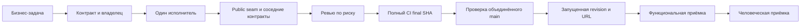

# AI Development Workflow v2 — предложение

Это проект процесса, а не новая активная инструкция. До принятия действуют исходные правила. Обоснование: [failures](process-failures.md), [reviews](review-effectiveness.md), [testing](testing-and-ci.md).

## Один маршрут

Merge/release выполняются только в пределах фактического пользовательского разрешения. Граф не разрешает автоматический merge этой ретроспективы.

## Планирование

1. Прочитать AGENTS, CONTEXT, docs/agents/domain + issue tracker; relevant ADR при наличии, текущий ticket/spec и contract затронутого seam. Остальные отчёты/skills грузить по trigger.
2. Зафиксировать input identity, expected observable output, failure/recovery, frozen/editable boundary, supported callers и data confidentiality. Один owner на criterion; backend выход не ждёт ещё не существующий UI.
3. Разбить по public seams и зависимостям. Общий cache/source/result lifecycle описать до detail/export consumers. Изменение business meaning потребует конкретного решения пользователя; routine implementation choice — ответственность исполнителя.
4. Ready: нет unresolved blocker для owned scope, fixtures/verification seams доступны, downstream exceptions названы. Не копировать spec в каждый prompt: ссылка/ID/SHA и изменённый scope достаточны.

## Реализация и делегирование

По умолчанию один исполнитель владеет изменением и architecture decision. Субагенты оправданы независимым review либо disjoint ready tasks, например09 display и10 backend export после verified common contracts. Каждый получает baseline, authority, allowed files, completion criterion и evidence limits. Общее состояние/один файл одновременно не редактируют без owner. Shared workspace не равен isolated memory или Git worktree.

Перед edit: перечислить callers/tests/fixtures/config/exports/CURRENT docs. Behavior change: минимальный public-seam failing reproduction на baseline, затем минимальный fix и проверка neighbors. Existing correct behavior/docs не требуют выдуманного RED. Extraction сохраняет generation validation/error/cancellation. Для metric/data/output независимый expected calculation, membership/full rows/security проверка обязательна.

Handoff — одна таблица: base/head SHA; changed contracts/files; criteria expected→observed; test commands/result/env; findings/disposition; UNKNOWN/limits; next owner. Не пересылать весь приватный session log.

## Проверка и интеграция

Review matrix в [review-effectiveness](review-effectiveness.md) выбирает reviewers. Каждый указывает точный reviewed SHA, independent/self и что реально исполнял. Findings от разных agents дедуплицируются по root cause. Spec и Standards не объявляют full runtime PASS из чужого лога.

Focused checks во время edit. После последней production/test правки — full required suite один раз локально при доступной среде; final SHA проходит unchanged mandatory CI. Report-only правка не требует local full, но final-HEAD CI остаётся. После интеграции проверить main CI и затронутый live transition; release replay выполняет все утверждённые cross-feature критерии. Merge conflicts требуют проверки affected neighbors и full candidate, а не переноса старого PASS.

Одно окно публикации: подготовить итоговый report/evidence до push final candidate. CI result, который появляется позже, записывать в PR supplement с exact SHA/job link; committed doc честно указывает свой timestamp/pending gate. Не делать self-referential «этот commit уже прошёл ещё не созданный CI».

## Приёмка и статусы

| Статус | Что должно быть доказано | Чего он не доказывает |
|---|---|---|
|Code complete|Owned behavior реализовано; tests/docs/callers consistent|Final CI/merge/runtime/human|
|PR ready to merge|Reviewed exact head, blocking findings resolved, required CI success, privacy scope checked|Объединённый main и production readiness|
|Functionally accepted|Точный candidate/main, реальные действия/input/output, критерии и limitations|Человеческая бизнес-пригодность/production SLA|
|Human accepted|Ответственный логист проверил конкретную revision, UI/workbook и подтвердил business use|Capacity/security/operations beyond tested scenario|
|Production ready|Human acceptance и intended data/load, latency/retention/worker/security/operational требования проверены либо явно approved exception|Любой неиспытанный workload|

Статусы независимы: NPI-12 functionalPASS может сосуществовать с human/productionUNVERIFIED. Перед выдачей URL обязательны checkout/SHA/interpreter/port/served-asset check и native smoke. При занятом порте определить процесс, сохранить чужое приложение; дать проверенный alternate URL.

## Точные предлагаемые изменения (BEFORE → AFTER)

| Место | BEFORE | AFTER — предлагаемый текст/правило | WHY → EXPECTED IMPACT |
|---|---|---|---|
|AGENTS.md|Два pointers: issue tracker и domain|Добавить один conditional pointer: `For behavior changes or release acceptance, follow docs/agents/retrospective/workflow-v2.md after this proposal is adopted; record baseline/head and the served revision.` До принятия строку не добавлять|Сделать trigger конкретным; small always-loaded context, без10 новых roles|
|docs/agents/domain.md|Read CONTEXT/relevant ADR; glossary/ADR conflict|Добавить: `When changing a Product capability, inspect the CURRENT contract and update its affected consumers/documentation in the same change. Identify which parts remain NEXT/UNVERIFIED.`|11/12 нашли outdated readiness; уменьшить semantic drift|
|Agent task instructions|Shared execution requirements требуют independent Standards/Spec/Ponytail и full evidence на каждую task|`Select review axes by the risk matrix. Preserve independent data/security/contract checks. Record whether each reviewer executed tests or inspected evidence.`|Reduce repeated generic passes, retain critical oracles|
|code-review skill wrapper в repo|Глобальная skill разделяет Standards/Spec; missing local authority может усложнять процесс|В task prompt передавать fixed base/head, точный ticket path, affected contract и role completion. Skill не копировать/не менять автоматически|Меньше repeated discovery и scope ambiguity|
|Ponytail workflow|Универсальный третий broad pass|Targeted connected path: `Review the saved-identity/output boundary and confirmed load risks; deduplicate findings with Spec.` Для low-risk заменить обычным lean checklist|Оставить полезную technical экспертизу, убрать ceremonial подпись|
|PR checklist|Summary/Evidence/Merge Danger; no single findings ledger|Добавить компактные fields: base/head, served revision если UI, owned criteria, unique findings/disposition, exact CI job, human/production limits|Один актуальный final record, less duplicated docs|
|Definition of Done|Статусы scattered между local tracker/report/PR|Использовать пять определений выше, с criterion owner и exceptions. Local historical status сохранять, current disposition ссылать на Git/PR|Не путать merged с accepted или old tracker с current truth|
|Review protocol|PASS иногда только source/evidence, независимость implicit|`State separate session/self-review, reviewed SHA, executed commands and unexecuted limits; every blocker has a counterexample and disposition.`|Проверяемая независимость без повторного expensive full runtime|
|TDD protocol|RED/GREEN требуют на behavior; no uniform infra classification|`RED must reproduce the requested behavior on baseline. Environment/fixture failures are separate. Existing conformant behavior gets regression evidence.`|Не тратить время на fictional RED, не скрывать setup errors|
|Git/worktree|One fresh chat/worktree per task; старый personal checkout остаётся|Fresh worktree only when isolation needed; record baseline and owner. Completion includes verified start command+URL; never modify existing user's worktree implicitly|Сохранить безопасность и связать доставку с пользовательским запуском|
|Evidence retention|Много committed full traces/screenshots/drivers|`Retain durable oracle/RED-GREEN/unique observations/manifest; refer to earlier unchanged evidence, replay changed transitions, keep bounded bulk artifacts only with durable summaries.`|Уменьшить review diff/archive cost, сохранить воспроизводимость|

Дополнительные точные предложения по **содержимому текущих локальных skills**, выявленные source audit [E10/E12](evidence-index.md). Это потенциальные conflicts, не доказанные исторические destructive incidents:

| Skill / BEFORE | AFTER | WHY → EXPECTED IMPACT |
|---|---|---|
|`implement-spec` steps4–9 предписывают reset/merge/cleanup|Project-specific wrapper: `Use the user's authorization and preservation constraints before Git mutations; prepare a reviewable branch, stop at the authorized completion boundary.`|Текущий запрос запрещает cleanup/merge; user instructions уже имеют приоритет. Меньше accidental scope escalation; harm history UNKNOWN|
|`tdd` Seams требует подтвердить каждый seam|`Reuse explicitly approved public seams from the issue/spec. Ask only when a new seam changes the agreed contract.`|NPI уже имел approved HTTP/Node/Edge seams; возможное уменьшение repeated questions, elapsed impact UNKNOWN|
|`pr`/`domain-modeling`/`diagnosing-bugs` references `GLOSSARY.md`|`For this repository, use CONTEXT.md as the domain vocabulary via docs/agents/domain.md.`|Устранить lookup mismatch; не создавать второй glossary|
|`retro` reference предполагает diff как достаточный context (`receives a diff, so no exploration needed`), не запрещая exploration|`Review the changed public contract and connected callers, cache/error/cancellation paths; report your actual independent checks.`|02/07/Freshness/10 findings требуют connected flow; не доказано, что именно это правило вызвало пропуск|
|`to-spec` просит extremely extensive stories|`Write the criteria needed to decide scope and test observable behavior; reference shared contracts once.`|Возможное уменьшение контекста, без потери78 утверждённых критериев; savings hypothesis|
|Refactor issues02–08 `Status: complete`, unchecked lists/мало completion evidence|При следующем завершении append SHA, owned criteria и evidence links; исторические записи сохранять, текущий outcome брать из Git|Меньше contradiction между tracker и actual main. Не переписывать старую историю автоматически|

Изменения описаны конкретно, но ещё не применены к AGENTS/skills/settings/checklists. Внешние skills и глобальные настройки принадлежат пользователю.

## Ресурсы и retention

Preflight: exact interpreter + locked manifest, Node/Edge startup, isolated temp directory. Использовать совместимое existing env, pip check; dedicated env при dependency divergence. Измерять повторные installs, а не запрещать изоляцию.

После merge предложенная автоматизация сначала проверяет: branch действительно merged в verified main; tracked/untracked status полностью безопасен; owned processes stopped; unique evidence закреплено в manifest и privacy audit; путь временный и принадлежит задаче. Только reproducible generated artifacts eligible. Dirty worktree, пользовательский файл или единственный источник PASS исключается; owner решает его судьбу. Storage expiry заранее записывается. Никаких silent deletions и никаких cleanup сейчас.

## Проверка самого предложения

Пилот5 задач, затем сравнить unique findings/escaped defects/review turns/full reruns/CI minutes/evidence bytes с похожими рисками. Risk matrix нельзя использовать как повод пропустить edge case. Если escaped lifecycle defects растут, добавить targeted independent replay, а не возвращать три безразличных универсальных review на всё.

Отдельная независимая критика этой ретроспективы и disposition записываются в [improvement-backlog](improvement-backlog.md#независимая-критика).
