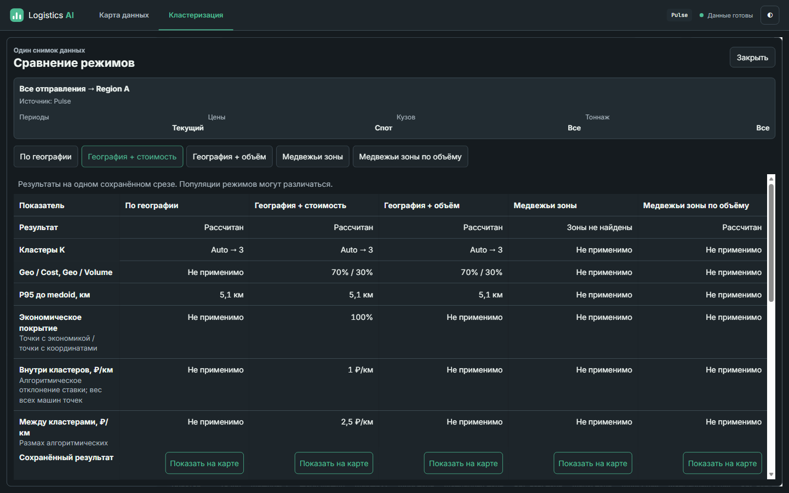

# Balanced UX08 — five-mode comparison and saved export

Accountable implementer and CX01–04 owner /root. Risk HIGH: saved identity,
modal focus and complete download. Parent e7b8ec907a90aa40ba35e04984336ce9ae28c075;
dependencies05/06/07 Quality62/63/64 SUCCESS before edits. Original base
4d21b54259c1a34a9d098a34aa518f447b411b65, isolated feature/balanced-ux-redesign.
Backend/API/schema/catalog/config/dependencies and XLSX writer remain unchanged.

## Owned behavior and preservation

Owned56 IDs comprise20 CMP and36 XLS/XDT fields in approved ticket08. Full294
integration belongs to10. Conditional fields are covered by source, rendered
tests, API checks and independent output oracles; these are distinct from native
replay. No winner, forecast, new business metric or store is introduced.

| Scope | Expected and observed |
| --- | --- |
| CX01 / CMP-context, mode, neutral | Five aligned columns share one frozen context/snapshot. Geography Auto, Geo+Cost/Volume Auto70:30 and catalog Bear presets are displayed from saved parameters. No winner styling. Ordinary and Bear populations remain distinct. |
| CX01 / remaining CMP metrics | Auto→actual K, P95, economic coverage, existing weighted MAD/spread, thresholds, candidates/zones/singletons/covered machines, resolved points, total machines, point/machine coverage and outliers remain available. Missing is unavailable, real0 remains0, inapplicable is explicit and no_bears means zones not found. Metric-valid point coverage is separate from machine coverage. |
| CX02 / cached activation | Switching all five modes and Geo+Cost A→B→A sends no run/revision request, synchronizes controls and resets to saved overview/default table sort. Mode focus stays within comparison. Escape closes, restores inert background and returns to Compare. |
| CX03 / XLS eligibility and operation | Export uses saved request/intent/snapshot/current raw sort, despite selected child, collapsed table, only50 loaded rows or a different form draft. Unsupported Bear, absent/rejected result and revision uncertainty prevent unsafe export. Cancellation suppresses late file/error; same-result drill-up retains the download; retry sends the same payload. Success states browser handoff, not disk persistence. |
| CX04 / remaining XLS and XDT fields | Actual downloaded books independently preserve all14 canonical columns, every assigned source-row ID/order, types, own metric-valid denominators, context/methodology/coverage/exclusions/sheet mapping, origin conflicts, UTC creation time and literal text. Empty/missing cells and numeric0 are distinct. Completeness or explicit failure remains backend-owned. |

Comparison reuses existing controller/state and renders one semantic table:
180px sticky labels plus five minimum220px columns, sticky header/actions and
labeled local two-dimensional keyboard scroll. Compare is reachable without an
inspector selection. Background inertness retains prior values on close. One UI
flag blocks export after failed/malformed revision validation; aborted validation
cannot poison a newer operation. Successful validation/reset clears uncertainty.

## Genuine RED → GREEN

Six baseline rendered failures covered aligned comparison, reachable entry,
missing/zero distinctions, separate populations and modal isolation; six passed
after the first increment in16.75s. Four network/malformed revision cases failed
before the uncertainty guard and passed with neighbors (30 cases,119.47s).
Two further failures exposed lost cached-tab focus and a zero-height matrix at
320px with doubled text. Final12 new cases passed in37.33s. Regressions are in
[test_dashboard_comparison.py](../../tests/test_dashboard_comparison.py).

Existing conformant export/cache behavior was verified without artificial RED.
The first full gates found one existing fixture trying to focus inert navigation
before hiding comparison (250/251 frontend and578/579 Python otherwise passed).
Independent Spec reproduced that browser restriction: after hide restores the
background, navigation accepts focus. The fixture now checks both blocked-before
and focus-after, preserving all result/cache/closure/no-request assertions. Its
focused rerun passed in5.47s; full gates are renewed after this last test change.
No controller change or mandatory-check waiver was made for the fixture.

## Actual Flask and Edge

Runtime is the isolated checkout at port5086/PID11092, original Python3.12.14,
Node22.23.3, Edge155.0.4283.45 and locked sklearn1.4.0. Entry point is the retained
safe `docs/design/dashboard-ux/evidence/audit_server.py --port 5086 --no-browser`.
Inputs are task-only89-row synthetic Pulse and12-location coordinates, never
private Pulse. Temporary adversarial source and stale-coordinate mutations are
byte-restored in finally; original tracked coordinate-cache bytes are preserved.
Final served-byte verification is recorded in local `08-final-served.json`;
artifact hashes are in `comparison08-runtime-manifest.json`, both under
`.scratch/balanced-foundation/`.

Final normal Edge matrix covers light/dark, six desktop sizes plus320×900,
root16/32 (28 checks). Actual125% Edge covers three desktop sizes in both themes,
root16/32 (12 checks), observed DPR1.2500000186. Matrix remains at least180px
usable height; overflowing panel content is scrollable. Native wheel observes
vertical400px normal and horizontal160/vertical320px at125%; header stays fixed.
Mode activation retains focus; Escape restores Compare. Independent narrow
double-text replay reaches the final Bear Volume action by strict center hit.

Retained drivers: `.scratch/08-comparison-native-layout.mjs`,
`08-comparison-native-zoom125.mjs`, `08-export-native-guards.mjs` and
`08-export-native-lifecycle-retained.mjs`; logs/observations live under
`.scratch/balanced-foundation/`. Actual held Flask export responds stale409 after
coordinate generation change and unavailable409 after task-cache eviction;
neither hands off a file. Native revision connection reset blocks export until
successful validation. Cached Bear export is unsupported without export HTTP.

Held successful responses canceled by Cancel, Calculate, Compare, cached
activation chain, Reset or Product exit abort and create no late file. Held late
error is suppressed. Native page navigation triggers pagehide: the actual held
AbortSignal is synchronously retained in task-profile sessionStorage and read
as true in the new document; no late file follows. The unload Runtime binding
event was not delivered in earlier driver attempts, so retained signal is the
independent transport-safe oracle. Same-result point-up does not abort and
completes a browser download. Native network error→Retry uses identical frozen
payload and completes another download. Isolated activation cancellation is
unit-covered; native Compare already cancels before its subsequent activation.

Earlier driver failures include corrupted assertion text and unload observation
transport/setup, not waived product failures. Logs and task profiles are retained.
No timeout or product behavior was weakened to accommodate these drivers.

## Independently reopened browser downloads

Separate reviewer /root/economics_spec reopened both actual Edge-downloaded
OOXML ZIPs, reconciling raw safe source and captured saved results independently
of production writer helpers. Read-only ArtifactTool imports/renderings also
reopened both unchanged books; native Excel application opening is UNVERIFIED.

| Download | Independent observed output |
| --- | --- |
| Normal,17388 bytes; SHA256 a89339cec4f01b24549070690cf40ee01db8f274d49e146c8803ffb8d4b2f671 |86 unique assigned source rows,570 machines,12 destinations; all14 columns/3 rows raw weighted-price ASC with cluster IDs0,1,2. UI had selected synthetic-00, only50 loaded rows, collapsed table and Geo+Volume draft; book remains saved Geo+Cost. Every raw row/value/order, frozen context/intent/snapshot, per-metric valid means and metadata matched. |
| Adversarial,19367 bytes; SHA256 b8dfefa15d8d9572a19982ecde2f9746393b2636632db0b637942ea9bcd3ab9c |88 unique assigned rows,570 machines,12 destinations. Two added safe zero-machine/price/route rows preserve numeric0 and blank rate; 000a/000001/00020 preserve leading-zero text. =SUM(1,2) and =1+1 remain literal inlineStr cells with no formula. Sanitized conflicting long region names produce legal unique mapped sheets. |

Normal file is retained as `08-download-normal/product-geo_cost-60bfe2945b86.xlsx`;
adversarial as `08-download-adversarial/product-geo_cost-6d46d2edb73b.xlsx`, beneath
`.scratch/balanced-foundation/`. Context capture, raw safe adversarial source and
independent JSON summaries/oracle scripts are retained with hash manifest.
Normal oracle SHA256 E001B9B3FBA8BAEDFF984FEEAD291F34E60B8B695B77714C60F4D0723DCA81AB;
adversarial oracle4856782121835AA9A05CFE40E533007F96377FADFA3C034612793241C74B2448.
Neither book contains formulas, macros, external links or invented rows. Existing
API neighbors cover other dangerous prefixes and complete-or-fail boundaries.

ADVISORY: existing writer column widths clip long headers in read-only workbook
rendering. Values/types are complete; writer formatting is inspect-only in this
ticket. Business workbook layout/human acceptance remains UNVERIFIED.

## Review and final gates

Independent /root/foundation_spec source Spec PASS on all56 owned targets; own
12 new and17 existing cache/revision/export neighbors, plus a narrow rendered
Edge probe (JavaScript interactions and strict rendered hit checks, not native
mouse/keyboard replay).
MAJOR narrow matrix and MINOR cached-tab focus findings were fixed and replayed.
Independent /root/economics_standards Standards and targeted Ponytail source
PASS; own23 connected cases and final6 focus/reflow/uncertainty cases. Separate
numerical/output reviewer independently reopened both books and ran296 API
neighbors (14.04s). Evidence inspection is labeled separately from native replay.
Final document/privacy/fixture scope reviews PASS. Five live assets independently
match served/source hashes. Final log/XML manifest refresh and publication mapping
follow these recorded gate facts; final-HEAD hosted Quality remains pending.

After the last production/test change, full local frontend251 PASS in666.36s and
Python579 PASS in315.74s. Nonempty JUnit contains zero skips/errors/failures.
151 candidate Python files pass Ruff; pip check and unchanged Quality Node/Edge
startup PASS. Frontend command uses original contract plus dashboard foundation,
layout, parameters, summary, table, inspector and comparison test files; Python
uses `pytest --ignore=tests/test_clustering_frontend_contract.py -ra` with
REQUIRE_FRONTEND_BROWSER=1, original checkout `.venv/Scripts/python.exe` and
unique basetemp directories. JUnit files are
`.scratch/comparison08-final2-frontend.xml` and
`.scratch/comparison08-final2-python.xml`; logs live in the local archive.

CX01–04 is not strictly VERIFIED until final-HEAD hosted Quality succeeds. Published07 is
the last verified head (Quality64 SUCCESS). Human and production readiness remain
UNVERIFIED; no merge, Ready promotion or cleanup is authorized. Tickets09–10 and
complete35-criterion/294-ID integration remain pending.
