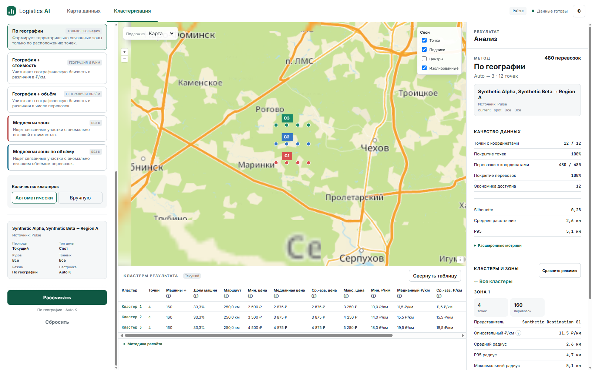
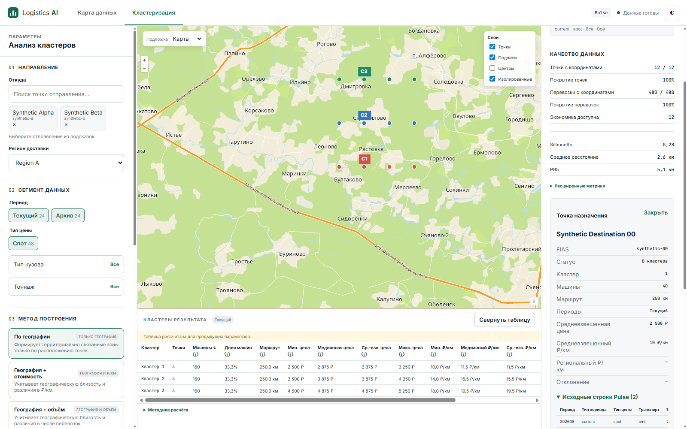
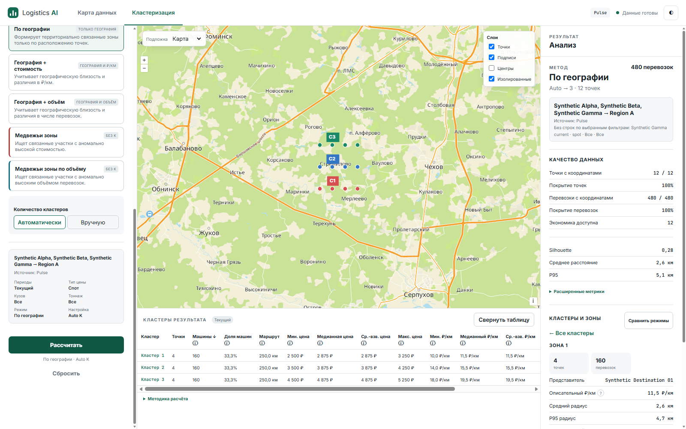
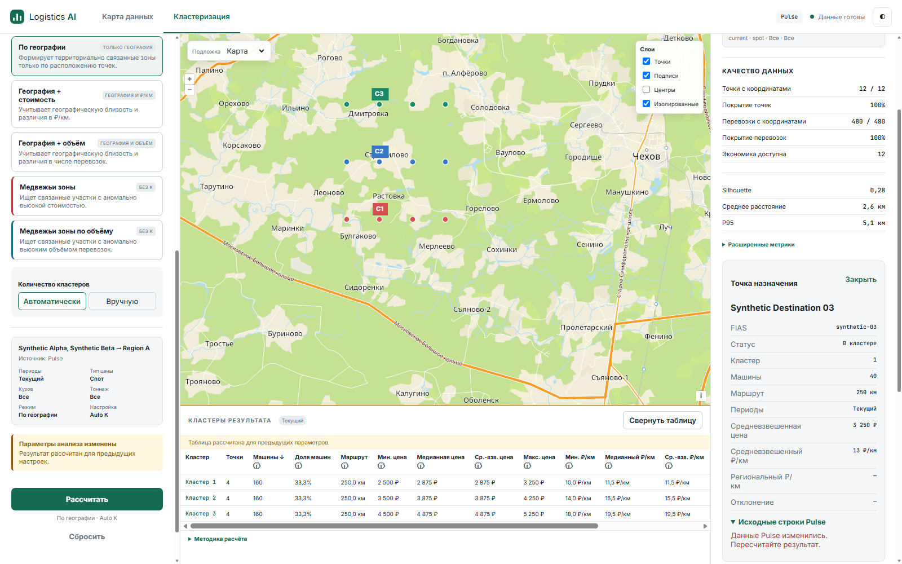

# NPI-04 IMPLEMENTATION REPORT

Implementation source: `2fc9ceb`, based on `origin/main` `8fda966` (PRs #5, #6, #8, #9, #10 merged). Isolated branch `feat/npi04-multi-origin`; existing worktrees, skills, hooks and untracked files preserved. Approved NPI-04 card is `.scratch/next-product-iteration/issues/05-explicit-origins-ui.md` in the original workspace; spec, coverage matrix, implementation order, execution requirements, CONTEXT and current Product contracts were read before implementation.

## Acceptance matrix

| Requirement | Evidence | Result |
|---|---|---|
| R1-01: several FIAS origins, add/remove | Canonical request regression; real Edge selects A/B/C and removes using mouse and keyboard | PASS |
| R1-03: one combined Product result | 12 destinations, 480 machines, weighted route 250 km, one map and three cluster-table rows | PASS |
| R1-05: common filters and one destination region | Archive/current recalculation produces 600 machines; retained valid region and removed invalid region regressions | PASS |
| R1-06: five modes, cached comparison | All five real backend modes; one comparison HTTP request, cached switches, P2 return-to-form | PASS |
| R1-07: frozen context and cache lifecycle | Edited form preserves map, table, inspector and frozen detail request; generation conflict and result eviction recover | PASS |
| R1-10: explicit origins UI, excluding All | Tokens survive empty/error searches; duplicate selection is idempotent; late responses cannot reopen popup | PASS |
| Canonical requests / one-origin compatibility | Sorted unique `origin_fiases`; existing scalar API callers remain supported | PASS |
| P1/P2 preservation | Real 409 generation conflict, failed refresh, fresh run/comparison; saved-result eviction and same-generation recalculation; existing regressions | PASS |
| Keyboard and clear errors | Arrow/Enter selection, Escape, Tab/Delete removal, visible focus, Enter validation; NO_DATA preserves saved result | PASS |

## RED → GREEN

Regressions exercise existing public state/API seams and actual Product DOM/controller modules in Edge. Only HTTP is stubbed in frontend tests; live evidence uses real Flask and all five algorithms.

Recorded RED failures preceded fixes for canonical/frozen requests, selected tokens, frozen point details, error preservation, unavailable-result recovery, equivalent cached copies, reset during options loading, removal of the last origin serving the selected region, and late search after selection/Escape. The final race reproduced a reopened popup despite selection/Escape, then passed after invalidating pending searches and accepting only current responses. Raw RED logs are retained under `.scratch/npi04-evidence/red-*.txt`; representative logs are included in [evidence](npi04-evidence/).

## Real browser evidence

Actual Edge 155.0.4283.45, Node 22.23.3, Flask at localhost:5064. The driver uses real CDP mouse/keyboard input, network observations and screenshots. Dataset: 60 synthetic rows, three origins, 12 geocoded destinations; no production data. [Scenario observations](npi04-evidence/live-observations.json), [driver](npi04-evidence/live_edge.mjs), [fixture](npi04-evidence/live_server.py).

The driver completed 18 scenario checkpoints: empty validation; two-origin union; frozen region; independent search; frozen detail; recalculation; five-mode comparison; P2 form return; third origin with zero matching rows; NO_DATA; stale generation; failed refresh; successful recovery; fresh comparison; evicted result; recalculation; keyboard removal; keyboard calculation.

## Verification and reviews

Baseline: backend 386 passed; mandatory frontend Node/Edge 43 passed. Final full pytest: **438 passed, zero skipped** (386 backend, 52 frontend). Command: `REQUIRE_FRONTEND_BROWSER=1 python -m pytest -q -p no:cacheprovider --basetemp=.scratch/npi04-evidence/pytest-final-owned --junitxml=.scratch/npi04-evidence/final-results.xml`. The default Windows pytest temp directory was inaccessible; an isolated workspace temp directory resolved the environment errors. Locked dependencies installed without changes; `pip check`, Ruff over tracked Python, syntax checks for all frontend JavaScript and `git diff --check` passed. Node and Edge startup checks passed. GitHub CI on the documentation commit is recorded in the completion report and PR checks.

Independent Standards and Spec reviews passed on `2fc9ceb` with zero blockers. Ponytail passed after independently reproducing the resolved late-search race. Its earlier reset, region-removal and popup findings were fixed and covered by regressions. Review agents did not independently repeat the full live suite or pytest; those checks were run by the implementation agent. The first GitHub CI run exposed missing UTF-8 declaration in the generated test HTML (two locale-dependent text assertion failures); the shared browser harness now declares its actual encoding, matching the application page. [Initial CI evidence](https://github.com/a-man-or-a-person/AI_logistics/actions/runs/38136824505).

## Changed files

- `frontend/index.html`, `frontend/css/style.css`: selected-origin controls and focus treatment.
- `frontend/js/api.js`: canonical multi-origin query parameters.
- `frontend/js/clustering/{state,controller,controls,inspector}.js`: origin sets, shared options, frozen detail context, invalidation/recovery and accessible interactions.
- `tests/test_clustering_frontend_contract.py`: regression coverage through the existing frontend seam.
- `CONTEXT.md`, current architecture, Product contract/workflow and project brief: current multi-origin behavior.
- This report and synthetic evidence artifacts.

## Limits and merge gate

No All button, summary, drill-up, XLSX, ATI, new algorithms, Graphify or dependency changes. Browser evidence is automated actual Edge, not a human walkthrough; CUA browser provider was unavailable. Production-scale performance and additional mobile/browser layouts were not evaluated. Backend algorithms and persistent data formats are unchanged; rollback is a normal commit revert.

READY TO MERGE requires successful mandatory GitHub Quality verification on the final PR HEAD. No automatic merge is authorized; the final completion report records the gate outcome.
