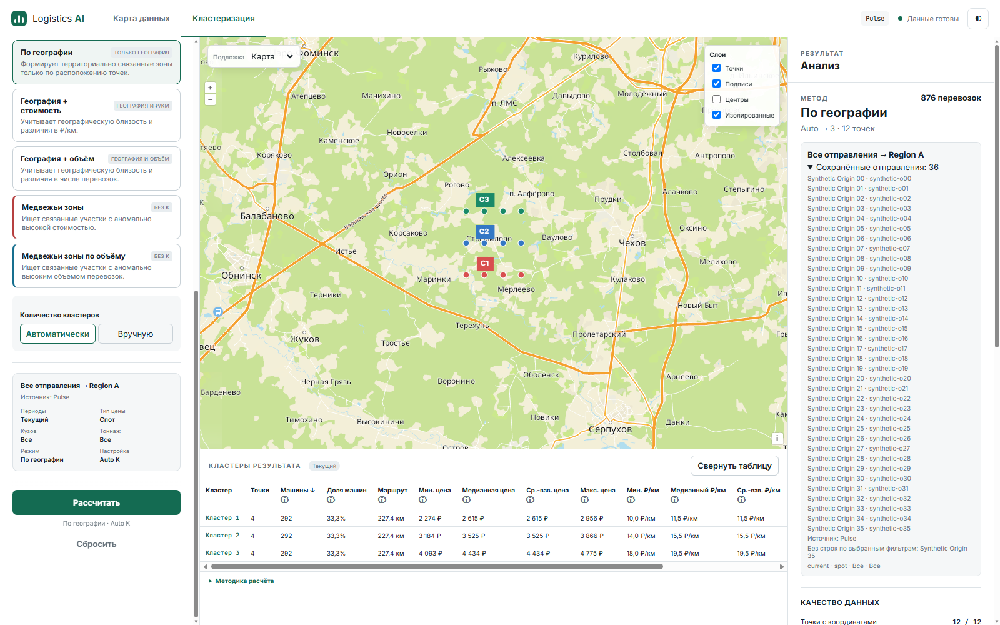
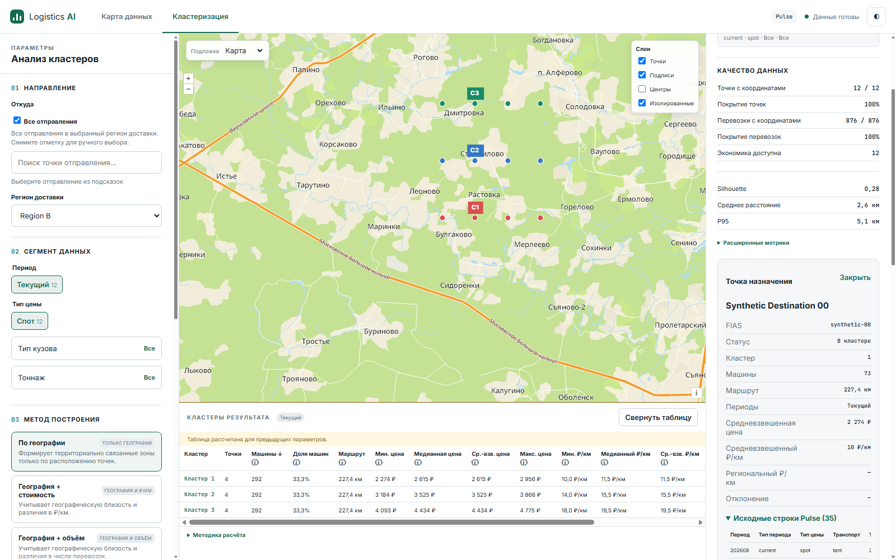
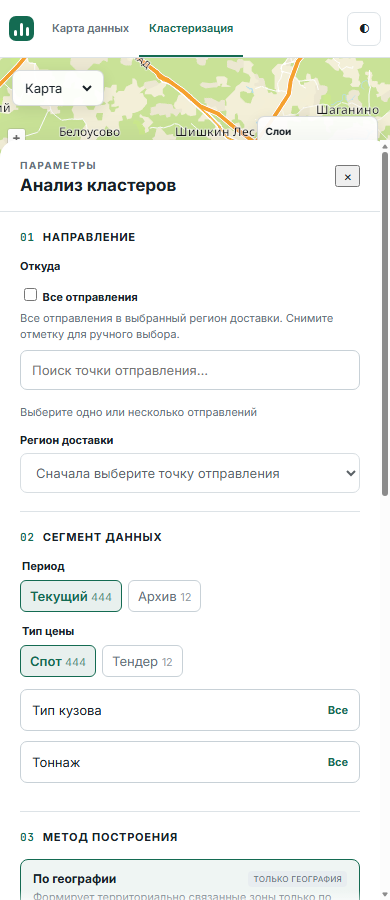

# NPI-05 implementation and acceptance

Source: `109259f`, based on protected `origin/main` `9e77a7de34cacf52628423b0b83bccbcf9aa8c89`. Remote SHA verified with fetch/ls-remote and GitHub branch API (`protected=true`). Prerequisites [NPI-03 #10](https://github.com/a-man-or-a-person/AI_logistics/pull/10) and [NPI-04 #11](https://github.com/a-man-or-a-person/AI_logistics/pull/11) are merged. Isolated branch/worktree: `feat/npi05-regional-all-ui`; existing checkout, worktrees, untracked artifacts and skills preserved.

Approved authority read in the original workspace: `.scratch/next-product-iteration/issues/06-regional-all-ui.md` (stable ID NPI-05), spec.md, coverage-matrix.md, implementation-order.md and execution-requirements.md. CURRENT domain/architecture and Product contracts read. Existing agreed seams: frontend state/DOM in Node/Edge and real Flask with synthetic Pulse. No historical status was rewritten.

## Acceptance matrix

All observations below use Edge 155.0.4283.45, Flask localhost:5065, synthetic CSV/coordinate cache, actual CDP mouse/keyboard input and rendered screenshots. [Driver and fixture](npi05-evidence/), [20 checkpoints](npi05-evidence/live-observations.json), [canonical HTTP evidence](npi05-evidence/canonical-http.json). Browser automation is actual input; it is not a human walkthrough.

| Criterion / obligation | Input/action | Expected and actual | Evidence | Status / limitation |
|---|---|---|---|---|
| **R1-02 (owned, exact approved criterion)** | Activate All without choosing origin-region; choose Region A and Calculate | Complete R-serving origins, including beyond suggestions; unrelated origin absent. Actual: 36 resolved origins vs 30 suggestions, 12 pooled destinations, 876 machines, three shared cluster rows; foreign Region B origin absent | Checkpoints03/04; HTTP All request/result; screenshot03 | **PASS**, synthetic workload |
| **R1-08 (owned, exact approved criterion)** | Add synthetic-new and 12 source rows after All result; open uncached detail; fail one refresh, then Calculate unchanged filters | Saved set stays36; source conflict409; failed refresh preserves display; successful fresh run resolves37 and new snapshot | Checkpoints09–11, HTTP, screenshots09/11 | **PASS**, file-generation mechanism |
| R1-03 / zero-match | Origin35 has tender rows; current/spot selected | Origin35 stays in saved set with zero-match explanation and contributes no metrics | Checkpoint03, origin_coverage and screenshot03 | **PASS** |
| R1-05 / explicit compatibility | Empty manual submit; switch All off; select origins00/01 | Empty does not become All; manual payload contains sorted origin_fiases and no All; manual labels retained | Checkpoints01/14; Node singleton/scalar and existing API tests | **PASS** |
| R1-06 / NO_DATA | Retro+tender All run | Typed NO_DATA422; previous frozen context/map/table retained | Checkpoint08 and HTTP | **PASS** |
| R1-07 / frozen edit | Change region toB before recalculation; open point rows | Saved Region A and membership unchanged, stale-form visible; rows use old region/filters/mode/snapshot/resolved36 | Checkpoint05, screenshot05; Edge filter-edit regression | **PASS** |
| Region selection/switch | All with no region; A→B→A | No run before region, visible validation; Region B resolves only foreign origin; A restored independently | Checkpoints02/06, HTTP; global-options API regression | **PASS** |
| Same-set calculations and intent (I-01 supporting) | Send equivalent explicit resolved36; use All compare cache | Points/clusters/table exactly identical; All label/provenance retained; frontend cache distinguishes selectors | Checkpoints04/07; Node/Edge cached-All test; same-set API tests | **PASS** |
| Frozen detail identity / I-04 | Open saved detail after form edit; evict backend result and reopen | Detail sends explicit frozen origins, never All; exact saved mode/parameters/membership; eviction409 RESULT_UNAVAILABLE then explicit recovery | Checkpoints05/12/13; HTTP, existing membership/API and Edge regressions | **PASS** |
| Five modes / P2 | All compare; Bear Volume→cached Geography; Archive edit | Five backend modes use same All dataset; request-free switch; checked/form/preview method stays Geography | Checkpoint07; existing mandatory P2 tests | **PASS**; Bear retains its existing table policy |
| P1 / NPI-04 lifecycle | Source conflict, failed refresh, fresh run/compare; reset/late options/manual switch | Rejected result cannot return via caches; fresh request/new snapshot; old display retained during failure; late options cannot overwrite new/reset selection | Checkpoints09–13/17; new race test and existing reset/search/P1 regressions | **PASS** |
| R1-10 / keyboard | Arrow/Enter origin selection, Space All toggle, Enter Calculate | Native controls respond; selection agrees with submitted intent; visible focus style | Checkpoints14/15/15b and screenshot15 | **PASS**, automated real keyboard |
| Responsive All controls | 1366×900,1100×900,390×900 | All control/hint remain within viewport, mobile controls sheet opens | Checkpoints16 and screenshots16 | **PASS** for this control; existing table remains desktop-only |
| INVALID_REQUEST | Missing region/empty selection; API invalid/mixed selectors | Visible frontend validation; existing typed API400 unchanged | Checkpoints01/02; regional API parametrized tests | **PASS**, malformed JSON through HTTP tests |
| Production capacity / downstream features | No supplied scale/SLA; summary/XLSX/ATI outside NPI-05 | No new cap or capacity promise | Fixture456 rows,36 regional origins,12 destinations; new generation468 rows/37 | **UNVERIFIED** production capacity; downstream acceptance belongs to its tickets/NPI-12 |

## Actual RED → GREEN

Each production correction followed its behavioral RED:

1. [RED intent](npi05-evidence/red-intent.txt): request still contained origin_fiases, All selector/intent absent. [GREEN](npi05-evidence/green-intent.txt): explicit All and manual/scalar regression pass.
2. [RED control](npi05-evidence/red-control.txt): actual Edge reported missing explicit All control. [GREEN](npi05-evidence/green-control.txt): region validation, options/run All, frozen explicit detail, preview/saved labels and manual return pass.
3. [RED comparison](npi05-evidence/red-comparison.txt): activating saved All after manual edit produced mixed selectors and falsely stale unchanged All form. [GREEN](npi05-evidence/green-comparison.txt): saved comparison dataset replaces current selector rather than merging it.
4. Live UI exposed an inaccurate frontend fixture assumption: unselected backend options returned no regions. [HTTP RED](npi05-evidence/red-regions.txt): expected both regions but got []. [GREEN](npi05-evidence/green-regions.txt):75 regional/repository tests pass after exposing the existing full region index. Scoped manual options remain restricted. No weighted formula or All resolution changed.

Existing conformant races/P1/P2/Bear/scalar protections have regression evidence; no fabricated RED. Early browser startup inside sandbox timed out; real Edge tests ran with sandbox escalation. The live fixture's foreign rows initially repeated one destination and were corrected before final evidence. Reset driver initially missed an offscreen footer button; final run scrolls it into view and passes. These were evidence setup issues, not production fixes.

## Canonical behavior

```json
{"all_origins":true,"destination_region":"Region A","period_types":["current"],"price_types":["spot"],"vehicle_types":[],"tonnage_ids":[],"mode":"geography","parameters":{"k_mode":"auto","n_clusters":"auto"}}
```

Backend returns `analysis.selection_intent={"all_origins":true}`, sorted resolved `analysis.origin_fiases`, labels/zero-match coverage and an explicit `analysis.frozen_request` without All. The unchanged form compares against its All request intent, not resolved origins. Options use `all_origins=true&destination_region=Region+A`; without region, unselected options supply the complete region list. Neither q nor limit constructs All.

Point rows copy frozen_request plus data_snapshot/destination_fias/offset/limit. Editable selection and backend expansion never overwrite the saved membership. Compare resolves All once in backend; frontend retains All cache context and saved result label. Switching off All restores retained manual tokens and checks their available regions; it does not turn the resolved catalog into manual selection.





## Verification

Final full suite: **443 PASS /0 failures /0 skips**, including **56 mandatory Node/Edge frontend checks** and387 backend tests. [JUnit results](npi05-evidence/pytest-results.xml). Exact command:

```powershell
$env:REQUIRE_FRONTEND_BROWSER='1'
..\..\.codex-impl-env\Scripts\python.exe -m pytest -q -p no:cacheprovider --basetemp=.scratch/npi05-final --junitxml=.scratch/npi05-final.xml
```

Locked requirements installation and pip check passed without dependency changes. Ruff passed; all frontend JS files except vendored ol.js plus live driver passed `node --check`; `git diff --check` passed. Existing Node/Edge startup self-check passed. Versions: Python3.12.14, pytest8.3.5, Ruff0.9.10, Node22.23.3. Local Ruff scanning encountered inaccessible owned pytest temp directories, but all tracked/new Python files were checked; GitHub uses a clean checkout.

Required GitHub Actions `verification` must be successful on the final published HEAD. Its run/job URL and conclusion are recorded in the PR/completion report after publication; no CI success is claimed here before that check.

## Independent reviews and Ponytail

Independent Standards and Spec agents inspected `9e77a7d...109259f` and connected lifecycle code. Neither independently reran the full suite/browser walkthrough.

**Standards:**0 blockers. One low CURRENT-doc inconsistency (workflow diagram still said API-only) was fixed. One judgment-call duplication of two short route labels was retained: it predates this change, both contexts have regression coverage, and a new shared formatter is unnecessary for this narrow change.

**Spec:**0 findings, PASS for owned R1-02/R1-08 and supporting frozen selector/cache/detail/manual-switch/mode requirements. No prohibited scope or weighted change.

**Ponytail (after both reviews):**Ship,0 must-fix findings. Inspected all changed request/options callers, state/cache/compare/detail paths, fixture and tests. Reused existing checkbox/options/controller/inspector and backend index; no dependency, algorithm, abstraction or cap. Assumed local desktop workload, not production SLA. The two-line label repetition is cheaper than a new interface here. Reviews apply to source109259f; subsequent changes are evidence/docs and the corrected workflow diagram.

## Limits / merge gate

No origin summary, drill-up, medoid display, XLSX, ATI, new algorithms or weighted changes. Actual Edge walkthrough is automated; CUA browser inventory failed with an invalid-JSON provider error, so no separate human walkthrough is claimed. Only selected responsive control layouts tested; no broad mobile acceptance or production-load promise. In-memory cache lifetime and generation contracts remain as before. No automatic merge.

READY TO MERGE is conditional on final-HEAD required verification; final result is reported in the PR and completion message.
