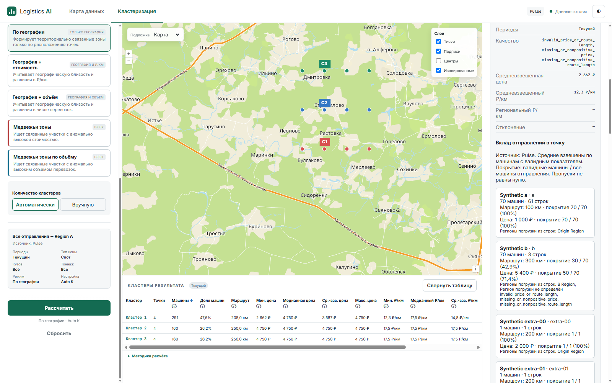
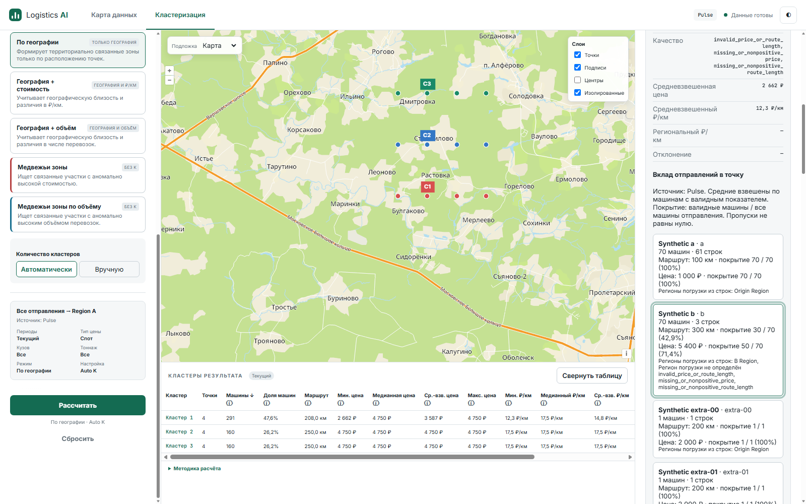
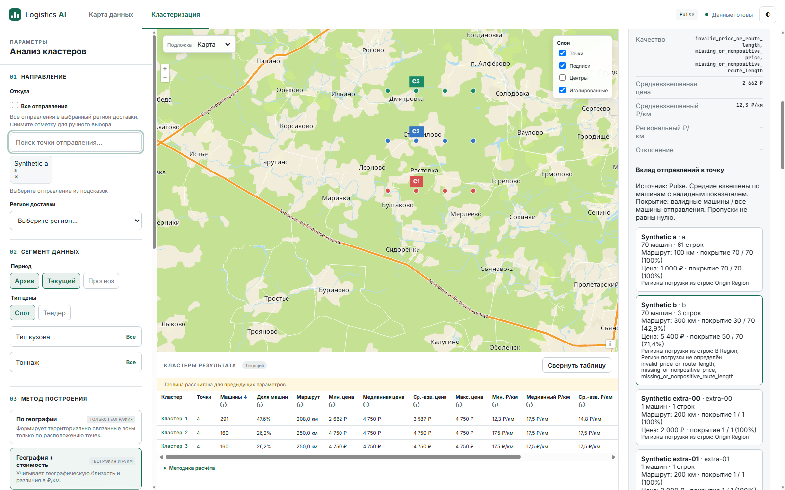
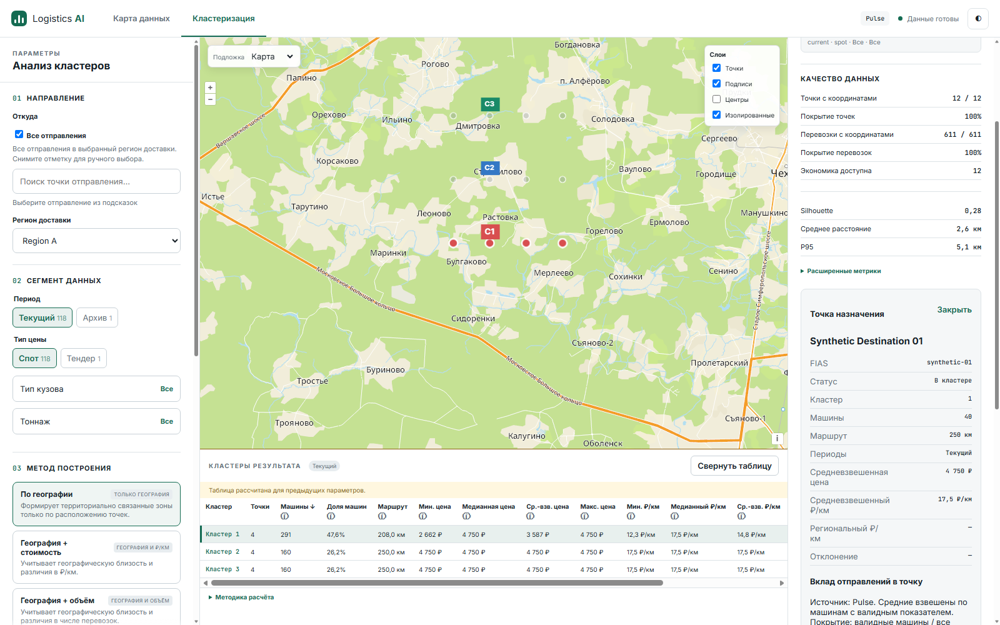

# NPI-07 implementation and acceptance

Baseline: protected `origin/main` fetched to `d27d799d870cae8012b7c6a42b71c6df761852bd` on 2026-10-11 (Europe/Moscow). [PR #12](https://github.com/a-man-or-a-person/AI_logistics/pull/12) is merged; its exact HEAD `1958f6091d38a06d3dda29f108fd9dca3f408f67` passed required [verification](https://github.com/a-man-or-a-person/AI_logistics/actions/runs/38139177429/job/114469285218), including all frontend and backend steps. NPI-02/#8, NPI-06/#9, NPI-03/#10, NPI-04/#11 and P1/#5/P2/#6 are ancestors with their contract/evidence retained. NPI-03 evidence is in the committed approved card; NPI-04/05 have implementation reports. Original checkout, unrelated worktrees/untracked files, skills and hooks preserved. Branch `feat/npi07-origin-summary` in `.worktrees/npi07-origin-summary`.

Authority read: original workspace `.scratch/next-product-iteration/issues/07-point-origin-summary.md`, approved spec, coverage, tracker, implementation order and execution requirements; prerequisite cards/evidence, CONTEXT, architecture, brief and Product contracts. Existing spec-approved seams: Product HTTP, Node/Edge frontend and real Flask with synthetic Pulse. Filename prefixes differ from stable NPI IDs.

## Exact owned acceptance matrix

Environment for all live rows: Windows, Edge155.0.4283.45, Node22.23.3, real Flask localhost:5067, synthetic Pulse/coordinate cache. Actual CDP mouse/keyboard input and screenshots; **automated browser evidence is not human acceptance**. [Observations](npi07-evidence/live-observations.json), [HTTP network](npi07-evidence/live-network.json), [fixture](npi07-evidence/live_server.py), [driver](npi07-evidence/live_edge.mjs).

| ID / exact approved criterion | Input/action | Expected / actual | Evidence | Status / limits |
|---|---|---|---|---|
| **R3-05:** point origin summary isolates A100/B300km and respective machines/price valid denominators from same frozen rows. | Select shared X, All34; inspect A/B; independent price-only B row | A70 machines,100km,D70,price1000,D70; B70,300km,D30,price5400,D50. Actual matches; route42.9%,price71.4% for B | HTTP tests; live03/07 | **PASS**, synthetic values; future workbook evidence delegated |
| **R5-01:** select point X: separate inspector summary shows contributing origin rows with machines/distance/price and metric coverage, bottom table unchanged. | Select X then A, load more |33 contributors, zero-match C absent from contributors but retained in saved selection. One destination marker; bottom table values unchanged | Live01/03/05; summary screenshot | **PASS**, desktop |
| **R5-02:** choose origin A by click/keyboard: first page contains only A→X frozen rows; source context labels visible and correct. | Mouse A, Tab from A to B, Enter | A page50/61, B page3/3; request copies saved34 origins, mode/parameters, filters, snapshot. Rows show actual origin FIAS and row regions; native button focus visible | Live04/07, HTTP row bodies | **PASS**, real automated mouse/keyboard |
| **R5-03:** Show more appends next≤50 newest-first rows with stable IDs, no duplicates or other origin leakage. | A Show more | Offset50, next11, unique61 IDs; Sept60 rows precede Aug1 row. No B/C leakage | Live04/05; existing HTTP pagination regression | **PASS** |
| **R5-07:** edit form while details open: rows/summary remain bound to old context and stale indication appears; new input not silently used. | Edit origins, Archive, method, then price/region | Summary and rows unchanged, no detail requests triggered; stale indication; old frozen request retained | Live08/15, Edge frozen-form regression | **PASS**; region edit to empty is a form-only state |
| **R5-08:** simulated network error displays Retry; retry/loading/success operate within same context; rejected snapshot uses recalculation recovery instead of repeated failed page. | Inject503 summary and rows, Retry; mutate CSV, fail fresh run, recover; evict result | Retry succeeds in same context;409 STALE_DATA_SNAPSHOT/RESULT_UNAVAILABLE show recalculation, no repeated summary Retry; old display retained through failed refresh; successful fresh35/new snapshot | Live02/03/06/10–14; Node cancellation/invalidation regression | **PASS**, controlled failures |
| **I-09:** point origin summary totals/coverage reconcile with source rows and pooled point/table; region detail regrouping changes neither weights nor membership. | Compare source rows, summary, pooled X and saved cluster0; five real modes including unassigned Y | Counts/valid weights additive; actual row regions B Region/null retained. All membership/status copied from saved point, no separate clustering | HTTP five-mode reconciliation; live01/03/07 | **PASS** backend/UI; direction workbook grouping deferred to NPI-10/12 |

## Grain and frozen contract

`POST /api/clustering/point-origins`: saved canonical resolved origin set + region/four filters + mode/normalized parameters + snapshot + destination FIAS. Scalar with mode/parameters also works. Summary grain is **one contributing origin FIAS × selected destination**, never origin region or origin×cluster recalculation. Returns snapshot/destination/saved cluster/status and sorted origins with name/ID, distinct actual row regions (including null), row count, machines, weighted route/price/rate, independent valid-machine counts and warnings. Coverage denominator is that origin's total positive machines; missing metric is null. Zero-match selection stays in existing analysis metadata.

Shared `_frozen_point_rows` retains NPI-02 exact result validation/source read and membership. Summary reuses `aggregate_clustering_records`, which uses the existing valid-row accumulator; no second calculator. Full rows feed summary, never a capped detail page. Attribution to cluster is the saved destination join. `point-rows` retains scalar compatibility, max50/newest-first/stable IDs and optional `detail_origin_fias`; outside saved set remains UNKNOWN_ORIGIN422. Summary requires mode/parameters and never accepts/re-expands All. Eviction/restart: RESULT_UNAVAILABLE409, no rerun. Source/coordinate generation checked before read and after summary construction.

Frontend stores summary by result-context/point and pages by result-context/point/origin. Native buttons expose aria-pressed and visible focus. Parent/result changes cancel/ignore late replies. Summary and origin pages share P1/P2 cache invalidation; form edits keep old saved context. Existing pooled Pulse disclosure remains available; selecting origin opens its first page. Bottom table columns/formulas/Bear semantics are unchanged. No drill-up/history framework.

## Independent hand calculations

| Synthetic slice | Expected | Actual |
|---|---|---|
| Small HTTP fixture X: A10×100, B30×300, B20 missing both | Machines60; route10000/40=250; price190000/40=4750; rate700/40=17.5; coverage40/60 | Exact backend constants |
| Add B20 price4500, missing route | B machines70,route300 D30,price270000/50=5400,rate20 D30. X machines80,route250 D40,price280000/60=4666.666667 | Exact/approx assertions; denominators differ |
| Only A→Y, missing price |5 machines,200km D5; price/rate null D0; no fabricated B contributor | Exact summary/row constants |
| Live X: A baseline10 +60×1; B30 +missing20 +price-only20;31 extra origins×1 | Rows95; machines171; A70,B70,extra31. Route(7000+9000+6200)/131=169.465648855; price(70000+270000+62000)/151=2662.251655629; rate(700+600+310)/131=12.290076336 | Live01/03 HTTP values match |
| Live saved cluster0: X plus destinations01/02/03, each40 machines | Machines291; route52200/251=207.968127490; price972000/271=3586.715867159; rate3710/251=14.780876494 | Live01 saved table matches; members00–03 |
| Complete live result |34 selected origins (C zero-match),33 X contributors;12 destinations;611 machines;119 CSV rows incl tender C and Archive A | Matches; table totals291+160+160=611 |

Frozen/source evidence: initial34 remains unchanged after new origin is added. Uncached summary rejects old snapshot. Failed refresh keeps old display; successful All run resolves35 with a different snapshot; fresh summary/detail succeed. Evicting same-generation saved result yields RESULT_UNAVAILABLE and explicit recalculation. Snapshot IDs, full frozen requests and saved membership are in network/observations, not inferred from the current form.

## RED → GREEN and regression gates

- Genuine HTTP [RED](npi07-evidence/red-summary.txt): missing `/point-origins`404. [GREEN](npi07-evidence/green-api.txt):18 summary cases plus existing union/regional tests. Existing conformant origin-filtered detail was verified, without manufactured RED.
- Genuine Edge [RED](npi07-evidence/red-ui.txt): `Origin summary missing`. [GREEN](npi07-evidence/green-ui.txt):59 mandatory Node/Edge cases. The first test draft used the wrong table ID; corrected before recording behavioral RED. Extraction initially omitted the existing final row-generation token variable; existing regression caught it and it was restored before GREEN.
- Live fixture initially lacked Archive rows; added one synthetic Archive observation before the final successful15-checkpoint run. Driver uses house mode-card labels and restores the explicit region after manual selection. These are fixture/driver corrections, not production defects.
- Final [full suite](npi07-evidence/full.txt)/[JUnit](npi07-evidence/pytest-results.xml): **464 passed, zero skipped**,59 frontend cases. `REQUIRE_FRONTEND_BROWSER=1 ../../.codex-impl-env/Scripts/python.exe -m pytest -ra -p no:cacheprovider --basetemp=.scratch/npi07-full --junitxml=.scratch/npi07-results.xml`.
- Locked install `python -m pip install -r requirements-lock.txt`, `pip check`, Ruff over all tracked/new Python, all frontend JS/driver `node --check`, `git diff --check`: PASS. Workflow runpy Node/Edge startup assertions and JUnit zero-skips assertion: PASS. Python3.12.14, pytest8.3.5, Ruff0.9.10.
- P1 source-conflict/failure/fresh recovery: live10–12; rejected caches and late responses: Node regression. P2 Bear Volume→cached Geography→Archive: live09, no new run/compare, checked method Geography. NPI-04 explicit selection/frozen errors, NPI-05 All34/saved35 and scalar/regional API regressions: full suite + live01/08/12. Five actual modes: HTTP summary-to-membership tests and live compare. LEGACY/RESEARCH suites pass.

Review-stage RED/GREEN: [cached selection RED](npi07-evidence/red-cache.txt) reproduced A?B?A leaving the wrong origin visible; handler now renders selected cached pages without fetching the next page. [Focus RED](npi07-evidence/red-focus.txt) reproduced native button focus lost on rerender; inspector restores focused origin, [GREEN](npi07-evidence/green-cache.txt). Final live07 asserts cached A61/B3 pages, request-free reselection and real Tab/Enter. [Selector RED](npi07-evidence/red-selector.txt) showed row-only detail_origin_fias incorrectly narrowing summary; summary now rejects it with INVALID_REQUEST400.

## Reviews and publication

Independent Standards/Spec and Ponytail review results, dispositions and exact final-HEAD Actions gate are recorded after review/publication in this report and the PR. No automatic merge. A previous-HEAD green does not satisfy the final gate.

## Limitations

Production load/capacity/SLA and confidential source data were not evaluated. Existing metadata fingerprints/in-memory result lifetime remain. Human acceptance is UNVERIFIED; this report describes actual automated Edge input/render/network observations. NPI-08 drill-up, NPI-09 representative changes, NPI-10/11 XLSX, ATI, new modes and formula redesign excluded; downstream workbook/release evidence remains delegated. Rollback is a normal revert; no migration or destructive source write in production.
