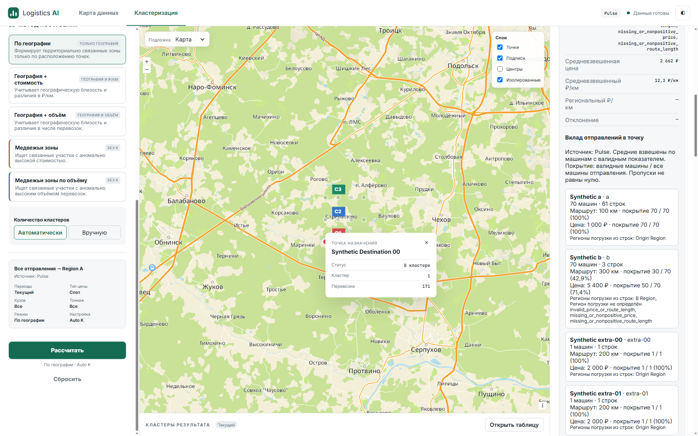
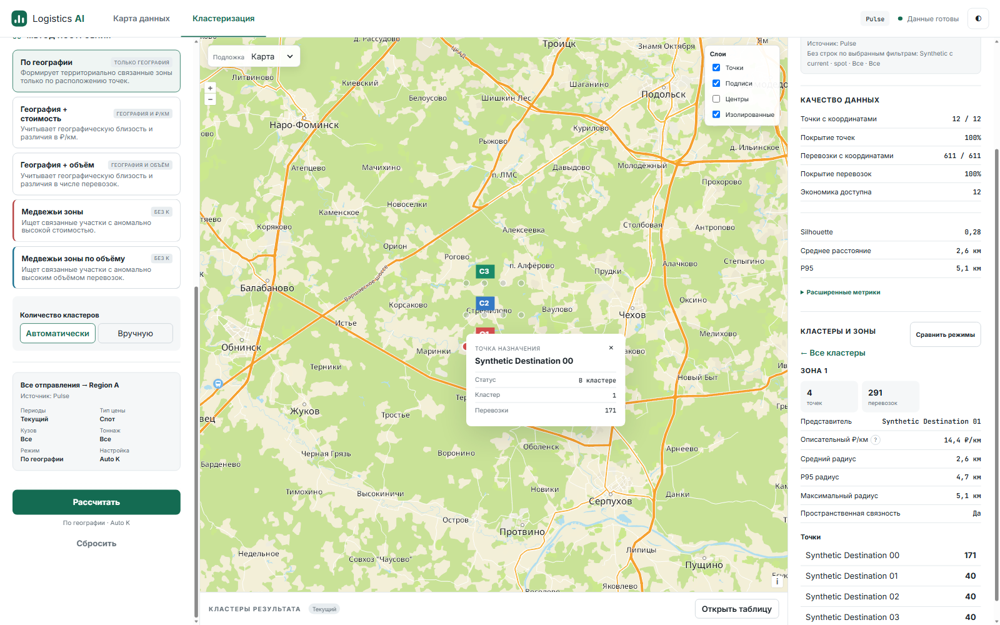
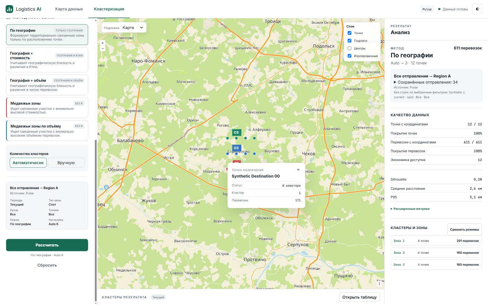
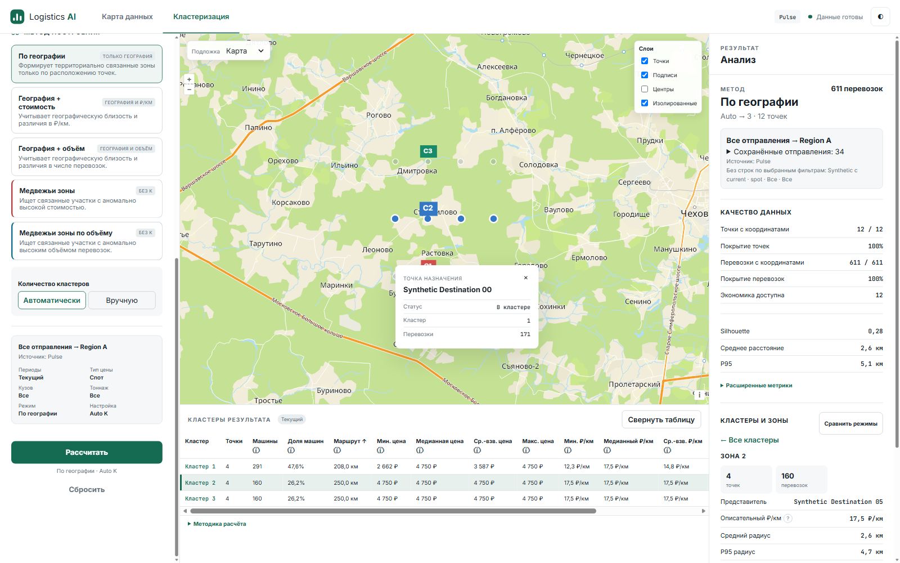
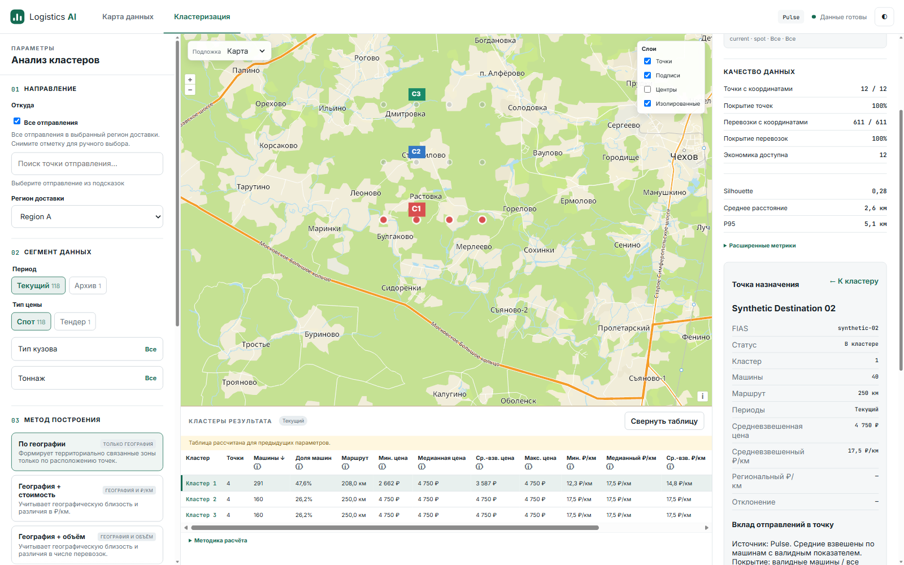
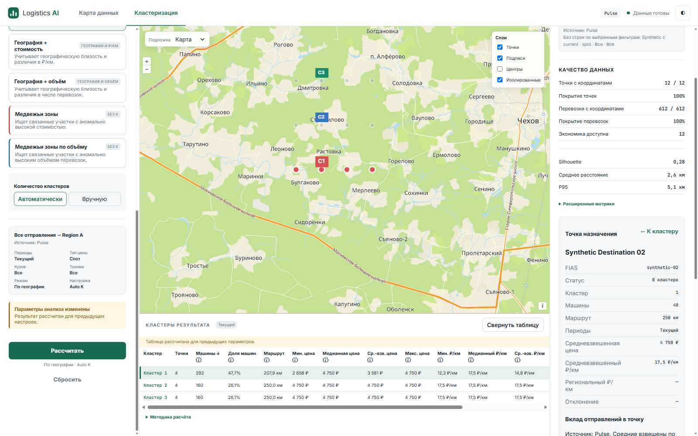

# NPI-08 implementation and acceptance report

Date: 2026-10-11 (Europe/Moscow). Repository: a-man-or-a-person/AI_logistics.
Source reviewed/tested: `c40c80f99c455e4d971e95119f13a03f7dc64c1a`.
Evidence/document publication commits change no runtime behavior.

## Verified preconditions

Latest fetched origin/main and GitHub branch API agree on `6cb7fd8e1e488bcde75c927cb41e67ee6bc1d68e`.
PR #13 merged as `e4ec549`; PR #14 merged as baseline `6cb7fd8`.
PR #14 exact HEAD98ec1a0 required verification succeeded: [run38146937061](https://github.com/a-man-or-a-person/AI_logistics/actions/runs/38146937061).
Main is protected by active [ruleset24839717](https://github.com/a-man-or-a-person/AI_logistics/rules/24839717): PR required, strict `verification`, no bypass actors, deletion/non-fast-forward blocked.
Classic branch-protection endpoint returned integration403; the active ruleset and branch protected=true were successfully read.

Approved local card `.scratch/next-product-iteration/issues/08-strict-drill-up.md` owns exactly the six criteria below.
Approved spec R5/coverage/tracker/order/execution requirements and Product API/workflow/CONTEXT/architecture/NPI-07 report were read.
Their historical blocked classification does not override verified merged prerequisites. No historical ticket was rewritten.
Isolated `.worktrees/npi08` preserves the original branch, unrelated untracked work, skills and hooks.

## Exact approved acceptance matrix

Expected behavior is the exact approved criterion in the first column. Environment for every row: Windows, actual Flask with safe synthetic Pulse, automated headed Edge155 at1600?1000 plus mandatory Node22/Edge contracts. Human acceptance and production capacity remain UNVERIFIED. Future export-control behavior belongs to NPI-11/12.

| Exact approved criterion / expected | Input/action | Actual | Status/evidence |
|---|---|---|---|
| **R5-04**: up rows→point summary→cluster preserves saved result/filter/sort context, no new clustering request. | Native A rows?point summary?cluster?overview; collapse and route-sort before up; reopen cached A61 | Saved result/context and request count unchanged; parent focus restored; same map center/zoom, sort and collapsed state. Scroll RED75/10?0/0 fixed and GREEN restores75/10. | **PASS**; 08a?d screenshots/observations; focused navigation and scroll tests |
| **R5-05**: all-clusters or different cluster clears old point/origin descendants; late pending response cannot reopen old context. | Hold native source-row request at transport; select another cluster; release; also overview/unassigned transitions | Point/origin descendants cleared. Aborted late response cannot reopen point. | **PASS**; 08e screenshot/HTTP; parameterized Edge parent tests |
| **R5-06**: valid cached comparison switch makes no run/compare request, shows overview/default trip sort and correct checked mode controls. | Five-mode real compare; Bear Volume?cached Geography; Archive edit | No run/compare on activation; overview/default trip_count descending; checked Geography and correct capabilities. | **PASS**; 09 screenshot/HTTP; existing cached-comparison and P2 contracts |
| **R5-09**: Tab/Enter operate parent/up/source controls with visible focus and understandable labels; browser-history integration not required. | Native contributor Tab/Enter; Shift+Tab/Enter up; mouse parent controls; delayed pooled rows | Readable Russian labels; visible native focus; origin?point button?cluster source?cluster card focus restored; pooled summary focus survives aborted finally. | **PASS**; 07,08a?c screenshots; RED/GREEN focus test |
| **R5-10**: table hover/selection and map point click select consistent cluster/point/inspector; unassigned point is honestly outside clusters, no fabricated parent/export membership. | Native map marker X; table cluster selection/hover; unassigned point Edge test | Saved cluster0/pointX/summary consistent; outside point has null parent and explicit outside-cluster label; no fabricated membership. | **PASS**; 02/03 map popup screenshots and HTTP saved cluster;08e; unassigned Edge test |
| **I-08**: collapse/reopen, sort, tooltips hover/focus/Escape/pointer-transfer still work; new selection/up/export controls do not hide errors/focus. | Native table collapse/reopen, route sort; help hover?pointer transfer?focus/Escape; existing errors/recovery | Collapse/sort/scroll and existing help behavior retained. Errors remain visible. No new export controls in this ticket. | **PASS**; 08a/d/f,10/13 screenshots; full table/tooltips tests |

## Navigation and frozen guarantees

```text
saved overview ? saved cluster ? destination point summary ? contributing origin/Pulse rows
                   ?                        ?                           ?
                   ??? point parent ??????????? explicit point-summary ??
cluster ? All clusters / overview
unassigned destination ? overview (no invented cluster)
```

Reuse existing map, table and inspector. Existing selectedCluster/selectedPoint/selectedOrigin and frozen caches own navigation; no new router/history/state store.
Up does not call run, compare or revision; it changes no mode, parameters, origin set/All intent, destination region, filters, snapshot or actual saved membership.
Parent changes abort detail requests and clear descendants; map point membership comes from saved points, not current form or event-supplied parent.
New form edits preserve the selected frozen cluster/point/rows and show stale indication. New calculations still invoke Pulse freshness/result-presence validation.

Keys retain frozen resolved origins, mode/parameters, region/four filters, generation and destination, plus detail origin for pages. Reentry safely reuses loaded summary and A61/B3 pages without paging/refetch.
Disconnected disclosure toggle events are ignored; native summary click records intent synchronously before async render can replace it. Summary/source focus and table scroll are restored using existing DOM/state.
Cached comparison resets overview and default trip_count descending, synchronizes mode radio/preset/form and supported table; no per-mode navigation history.

## Lifecycle and HTTP evidence

[Complete HTTP requests/responses](npi08-evidence/live-network.json) and [observations](npi08-evidence/live-observations.json) are one final successful21-checkpoint pass; source data is synthetic only.
Native marker click identifies saved X/cluster0; summary uses exact saved context. A first page50 plus11 gives61 unique rows. B3 rows retain actual origin-region attribution.
Up and cached reentry leave total API request count unchanged. Actual map center/zoom match before/after up.
Evidence-only interception appends a constructor observer to the browser's OpenLayers library to read the real map; production sources are unmodified, input still travels through native mouse events.

Hold point01 source rows, select different cluster by native table click, release: old descendants stay closed. Native tooltip hover/pointer transfer/focus/Escape succeeds.
P2: real five-mode compare?Bear Volume?cached Geography?Archive; checked mode agrees and no clustering request on switch.
P1/source freshness: add synthetic origin, select **uncached point02**: STALE_DATA_SNAPSHOT409. Previously loaded safe caches are deliberately reusable; choosing a cached point is not evidence of backend rejection.
Failed explicit refresh retains frozen display; next successful Calculate resolves All34?35/new snapshot and fresh A50 rows. Evict exact same-generation result: RESULT_UNAVAILABLE409, no retry-loop/substitution; explicit Calculate recovers.
Region/price/origin/period/mode form edits keep old details bound to saved request. Scalar, explicit-set, regional All and five-mode/Bear regression suites pass.

Final headed driver: [live_edge.mjs](npi08-evidence/live_edge.mjs), [Flask fixture](npi08-evidence/live_server.py), [execution](npi08-evidence/live.txt).119 synthetic CSV rows,12 destinations,34 selected origins,611 machines; C is selected zero-match; source mutation adds35th origin.








## Genuine RED ? GREEN

- [RED up](npi08-evidence/red-up.txt): missing point-summary control on untouched navigation behavior; [GREEN](npi08-evidence/green-up.txt).
- [RED parent](npi08-evidence/red-parent.txt): baseline controller retains old point/origin and wrong unassigned cluster. Corrected synthetic fixture member lists before recording behavioral evidence. [GREEN navigation](npi08-evidence/green-navigation.txt).
- [RED focus](npi08-evidence/red-focus.txt): loadingFocus/parentFocus false after canceled pooled rows. Corrected focus restoration passes same test.
- [RED scroll](npi08-evidence/red-scroll.txt):75/10 becomes0/0; corrected table renderer restores exact offsets.
- Nine final focused cases pass, including existing cached-comparison regressions. New behavior adds seven cases to existing public workspace/controller seams; no new test framework.

Initial sandbox Edge CDP timeout is infrastructure evidence, **not** behavioral RED. Actual Edge contracts ran successfully with local connectivity. Connected Node fixtures were updated for new map/table calls; old programmatic disclosure tests now use native summary activation. One duplicate fixture declaration was found and removed before final492-pass suite.

## Full gates and independent reviews

Final [pytest output](npi08-evidence/full.txt)/[JUnit](npi08-evidence/pytest-results.xml): **492 passed, zero skipped**, including **80 mandatory Node/Edge** cases,141.43s.
Command: `REQUIRE_FRONTEND_BROWSER=1 ../../.codex-impl-env/Scripts/python.exe -m pytest -ra -p no:cacheprovider --basetemp=.scratch/npi08-gate-final --junitxml=docs/npi08-evidence/pytest-results.xml`.
[Ruff/pip/JS/diff output](npi08-evidence/gates.txt), [locked install](npi08-evidence/locked-install.txt): PASS. Mandatory workflow runpy Node/Edge startup assertions: PASS.
Python3.12.14, Node22.23.3; final actual headed Edge155.0.4283.45. JUnit asserts all492 executed/no skips/errors/failures. No dependencies, algorithms, formula or backend changes.

Independent final source reviews atc40c80f: [Standards](npi08-evidence/standards-review.md)0 remaining blockers; [Spec](npi08-evidence/spec-review.md)0 remaining blockers; [Ponytail](npi08-evidence/ponytail-review.md)Ship. Review-stage labels/focus findings fixed and covered; table scroll observation fixed with RED/GREEN. Reviewers inspected connected code and evidence; they did not independently rerun full/native acceptance. Their standalone Edge attempts timed out and are not acceptance evidence.

## Publication and limitations

PR targets protected main. Exact final PR HEAD required verification/run/job links will be recorded in PR/completion after Actions; prior HEAD CI is never substituted. No automatic merge.

Automated **headed actual Edge native input** acceptance is complete; **human acceptance is UNVERIFIED**. Early driver runs were headless and exposed fixture/selector/cached-destination mistakes; final21-checkpoint evidence replaces them. Production load/SLA and confidential Pulse data untested. Existing metadata fingerprints cannot detect same-path/size/mtime content replacement; in-memory result lifetime and future eviction remain unchanged. Browser Back/per-mode history, medoid, XLSX, ATI, new clustering and formula redesign excluded. Future export criteria remain NPI-10/11/12 responsibility; no claim of full78-criterion release acceptance. Normal revert, no migration/persistent infrastructure.
