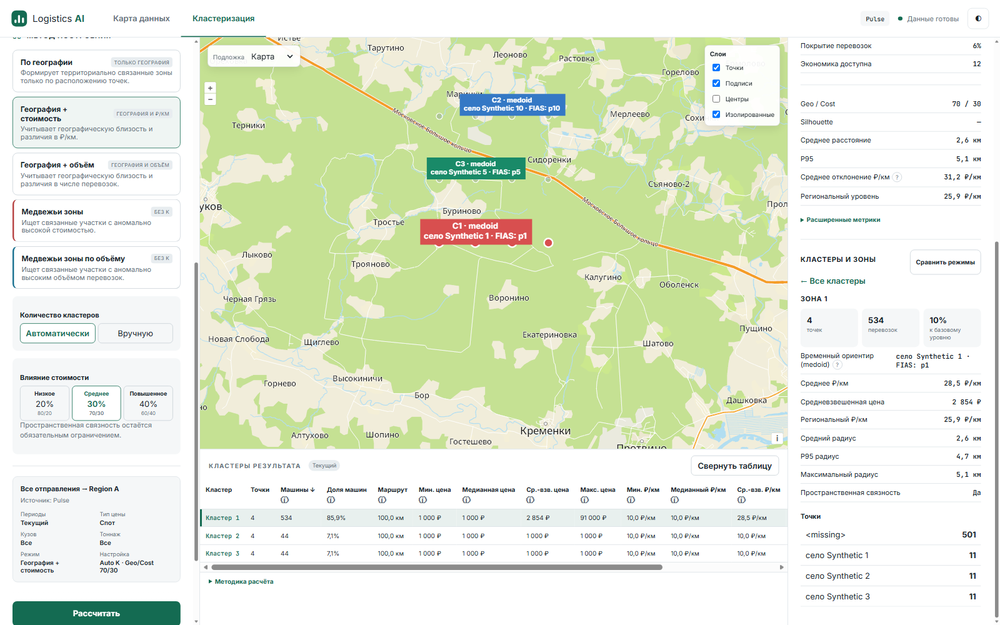
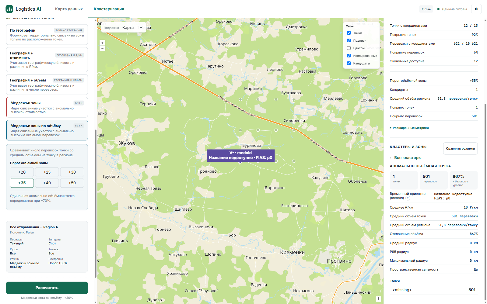

# NPI-09 — temporary medoid representative

## Decision checkpoint before display implementation

2026-10-11 (Europe/Moscow): user explicitly answered **«Подтверждаю временный medoid»**
to the repeated business review. Approved semantics: geographical reference, a real
assigned destination selected by the backend using unweighted projected distances;
no warehouse or transport-hub recommendation.

**НАВЕРНО / ВРЕМЕННО: представитель кластера = существующий medoid. До реализации
отображения повторно подтвердить, что географический ориентир соответствует задаче
менеджера; при появлении иной задачи пересмотреть. Не считать выбор окончательным.**
Any semantic replacement requires a new business decision. This checkpoint was recorded
before production display changes, independently of decomposition approval.

Baseline: `53c003797961c31c8160b0bfc1b69ea2cfa6c15b`, fetched protected main; branch
`feat/npi09-medoid` created at that exact SHA in `.worktrees/npi09`.
PR #15 merged; HEAD `49ba3ad75dbbfff322054e068c9cca583f1c1245` passed
[required verification](https://github.com/a-man-or-a-person/AI_logistics/actions/runs/38157762448/job/114524156012)
with all steps successful, including mandatory Node/Edge and zero-skip checks.

Authority: original workspace `.scratch/next-product-iteration/` approved NPI-09 card,
spec, coverage matrix, tracker, order and execution requirements. Existing approved
test seams: Product API, existing Node/Edge frontend, real Flask/synthetic Pulse.
No additional seam approval is needed. `/implement` is not installed; the explicit
task and approved TDD/execution requirements supply the implementation workflow.

Scope: existing medoid summary/API regression; shared presentation formatter,
map labels and inspector; focused tests and CURRENT documentation/evidence.
Algorithms, saved membership, frozen requests, source validation, navigation,
table columns and XLSX remain unchanged. No NPI-10 worktree or environment accessed.

Existing calculation: minimize sum of Euclidean distances in the local projection,
without trip weights. Ties choose first in existing input order; Product locations
are ordered by descending trips then ID. Identity is `medoid_point_id` and
`representative.point_id`; projected coordinates are `medoid.x/y`, geographic
coordinates/name come from the actual `LocationPoint`. Cluster `point_ids` is saved
membership. Unresolved points are excluded before clustering; negative assignments
have no summary. Singleton and coincident members use the same rule. Changes to data
or volumes can change membership/input order and therefore representative.

## Exact owned acceptance matrix

Environment: Windows, Python 3.12.14, Node 22.23.3, actual headed Edge 155.0.4283.45,
Flask at localhost:5069, safe synthetic Pulse and coordinate cache. Browser input
is native CDP mouse/key events; automated evidence is **not human acceptance**.
Fixture: 26 raw rows (25 current + 1 archive), 2 origins, 13 destination points,
12 resolved; source mutation adds a third origin/current row. Production capacity
and human acceptance remain UNVERIFIED; cross-feature release belongs to NPI-12.

| Exact approved criterion / expected | Input/action | Actual | Status / evidence / limitation |
|---|---|---|---|
| **R6-01**: representative is backend medoid ID in actual assigned member set, not centroid or invented city. | Synthetic x=0,2,10, largest volume at10; noise at2; real five-mode HTTP compare and map labels | Distance sums12,10,18 choose actual b at2; centroid4 differs. Every API/map representative belongs to saved assigned members and has that member's lat/lon. | **PASS**: base mathematical tests, medoid API test, live `mode-*` HTTP/screenshots. Synthetic geometry; no business optimum claimed. |
| **R6-02**: map/inspector display same recognizable locality/name/ID; lower-table columns unchanged. | Native Show on map for each cached mode, cluster selection, medoid label click; native point→origin→up; form edit | Same name/FIAS in OpenLayers text and inspector; non-city names retained. Three Geography tables retain saved values; Bear table unsupported. Map click selects its saved cluster. No run/compare on cached switch or up. | **PASS**: display Edge tests, live `mode-*`,02/04/05/06, unchanged table.js/API projection. 19 screenshots/25 checkpoints; existing label toggle still applies. |
| **R6-03**: identical dataset/order repeats same medoid including equal-distance case; no unchanged representative promise when volumes/data change. | Repeat API compare; repeat singleton/two-point/coincident summaries three times | Identical responses/IDs. Ties retain first existing order; Product order remains descending trips then ID. No algorithm or tie redesign. | **PASS**: base/API regression tests; contract/review. Volumes can change ordering/membership; stability beyond same input/order is not claimed. |
| **R6-04**: non-city locality allowed; missing source name visibly unavailable with ID rather than guessed city, missing-coordinate point never representative. | Non-city `село Synthetic`, real missing source name at p0/Bear Volume singleton; unresolved p12 with9999 trips; empty/sentinel names and36-character FIAS/long name in Edge | Map+inspector show «Название недоступно · FIAS: p0»; source detail name is null. p12 has null cluster/coordinates and never represents a cluster. Long inspector values wrap without horizontal overflow; HTML-significant names stay literal. | **PASS**: base/API tests, display Edge cases, live03/04 and `mode-bear_volume_zones-cluster-0`. Missing-name fixture uses existing explicit cache entry `<missing>::Region A`; no new coordinate resolver. |
| **R6-05**: NAVERNO/temporary review marker appears in next decomposition/review; any semantic replacement requires new decision. | Repeated business question before display; user answered «Подтверждаю временный medoid»; independent Spec review | Decision recorded above before production changes; НАВЕРНО / ВРЕМЕННО carried into CURRENT contract/report/review, inspector says temporary. New meaning requires new decision. | **PASS**: decision record and independent reviews. Temporal implementation check, no manufactured failing unit test for document approval. |
| **R6-06**: no extra reverse-geocoding/centroid-city calculation, warehouse recommendation or new Bear representative rule. | Review complete diff against baseline; real five-mode algorithms | Only presentation changes; existing backend medoid/assignments/resolver unchanged; no new request/calculation/dependency. | **PASS**: Standards/Spec/Ponytail reviews, API/full regression, live network. New business interpretation expressly excluded. |

## Mathematical, browser and RED → GREEN evidence

- Existing algorithm regression: x0/2/10 yields medoid2 (distance sums12/10/18),
  centroid4, largest trip volume at10. Noise at2 is excluded. Singleton, equal-distance
  pair and coincident pair repeat first member deterministically. No production
  algorithm change and no fabricated RED for these already conformant behaviors.
- Inspector [RED](npi09-evidence/red-inspector.txt): actual source locality lacks FIAS.
  [GREEN](npi09-evidence/green-display.txt): same name/FIAS for all five modes and
  explicit sentinel/empty-name fallback, escaped text and long values.
- Map [RED](npi09-evidence/red-map.txt): actual OpenLayers label is only C1.
  GREEN verifies rendered text and independently converts marker geometry back to
  expected lon37.02/lat55; removing clusters removes representative labels.
- Long-name [RED](npi09-evidence/red-wrap.txt): actual production CSS overflows inspector.
  Two local CSS rules restore wrapping; final test also uses a36-character FIAS.
- Public HTTP [regression](npi09-evidence/math-api.txt): all five actual algorithms,
  representative/member geometry, explicit unresolved exclusion, frozen source-row
  attribution, cached compare equality and true STALE_DATA_SNAPSHOT409. First fixture
  under-excited Bear Cost; corrected synthetic price before passing, no production fix.

[Live driver](npi09-evidence/live_edge.mjs), [Flask fixture](npi09-evidence/live_server.py),
[observations](npi09-evidence/live-observations.json), [HTTP requests/responses](npi09-evidence/live-network.json).
Final successful walkthrough uses native cluster/map-label/source clicks and
Shift+Tab/Enter for explicit up. Mouse selections and help focus expose the actual
representative line. Cached switches do not run/compare; up preserves map center/zoom.
Form edit preserves labels, inspector representative and table. Real CSV mutation
rejects uncached point detail409 while frozen labels remain; explicit Calculate
gets new snapshot/resolved origins and new backend representative context.
Evidence-only OpenLayers constructor observer reads the actual map; production
files are unmodified by interception. The driver corrects its own modal/control
selectors and resets its mutated fixture before the final pass.




## Independent reviews

Reviews pinned to implementation commit `c9abf8a460705863b3f51df8a0516bac61b47323`,
against `53c003797961c31c8160b0bfc1b69ea2cfa6c15b`. Later changes add evidence/report
and align one display-test fixture's member ID with its36-character representative
FIAS; the30 display checks are rerun. Production code is unchanged after review.

**Standards:** PASS,0 documented breaches,0 actionable smells. Shared formatter stays
in frontend ownership; HTML escaping/OpenLayers literal text, existing contracts and
minimal scope retained. No dependency/config/abstraction added. Reviewer did not
rerun tests/browser; implementation gates own that evidence.

**Spec:** PASS,0 findings. R6-01…06 implemented; authoritative medoid, actual coordinates,
same missing/name/FIAS, unchanged table/algorithms/Bear/frozen/navigation and explicit
temporary reaffirmation. No scope creep. Full/live gates remain implementation-owned.

**Ponytail:** Verdict Ship,0 actionable correctness/security/load/testing/lean findings.
Reviewer independently ran9 base/API cases. Load assumption: existing local Product;
production capacity is unknown. Publication/CI/live gates remained parent-owned.

## Final local quality gates

Final full suite: **528 passed,110 mandatory Node/Edge,zero skipped/failures/errors**,
verified from [JUnit](npi09-evidence/pytest-results.xml).
Final local runtime:247.353s. Initial pre-wrap full suite:523 passed,105 frontend,zero skips; final adds5 long-name
cases (one per mode). Focused display GREEN:30 cases; base/API:9 passed.
Final [gates](npi09-evidence/gates.txt) confirm Python3.12.14/Node22.23.3, actual
Node+Edge startup, locked dependencies/pip check, Ruff, every frontend JS syntax
check, driver syntax and `git diff --check`.
[Locked install](npi09-evidence/locked-install.txt) uses unchanged `requirements-lock.txt`.

Commands (from `.worktrees/npi09`, its own `.venv-npi09`; TEMP/TMP and pytest
basetemp isolated under its own `.scratch/npi09*`):

```text
REQUIRE_FRONTEND_BROWSER=1 .venv-npi09/Scripts/python.exe -m pytest -q -p no:cacheprovider --basetemp=.scratch/npi09-final --junitxml=docs/npi09-evidence/pytest-results.xml
.venv-npi09/Scripts/python.exe -m pip install --disable-pip-version-check -r requirements-lock.txt
.venv-npi09/Scripts/python.exe -m pip check
.venv-npi09/Scripts/python.exe -m ruff check . --extend-exclude .venv-npi09,.scratch
node --check <each frontend/js/**/*.js>
node --check docs/npi09-evidence/live_edge.mjs
git diff --check
.venv-npi09/Scripts/python.exe docs/npi09-evidence/live_server.py
node docs/npi09-evidence/live_edge.mjs
```

Required final-HEAD GitHub Actions verification is a separate publication gate;
its exact final SHA/run/PR URLs and READY TO MERGE status are recorded in the PR
and completion response after the run finishes. No merge is authorized.

## Changed files and limits

Production: `frontend/js/clustering/formatters.js`, `inspector.js`, `frontend/js/map.js`,
`frontend/css/style.css`. Tests: existing frontend/base files and
`tests/test_medoid_representative_api.py`. CURRENT docs: CONTEXT, architecture,
Product contract/workflow; this report and safe synthetic evidence.

No XLSX/NPI-10/11/12 implementation, reverse geocoding, new algorithms, largest-volume
representative, warehouse advice, new framework or shared planning updates.
No other agent worktree/environment accessed. No automatic merge.
Existing metadata-fingerprint/in-memory-cache limits remain. Labels can overlap
in dense maps; existing label toggle remains available. No new decluttering policy
or map scale/performance promise was requested. Human acceptance/production capacity
remain UNVERIFIED. Normal revert restores the previous presentation; no migration.
