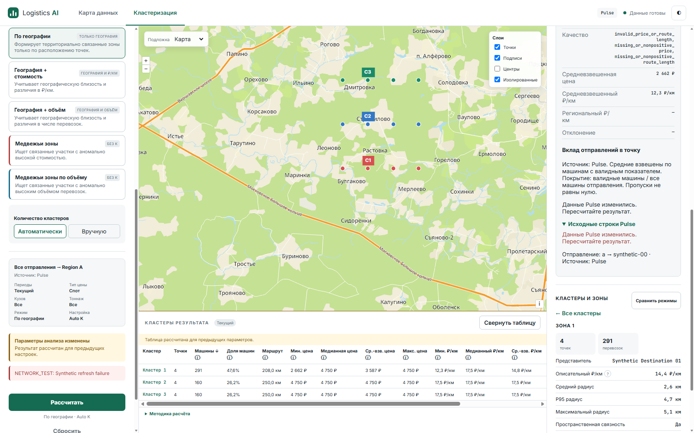
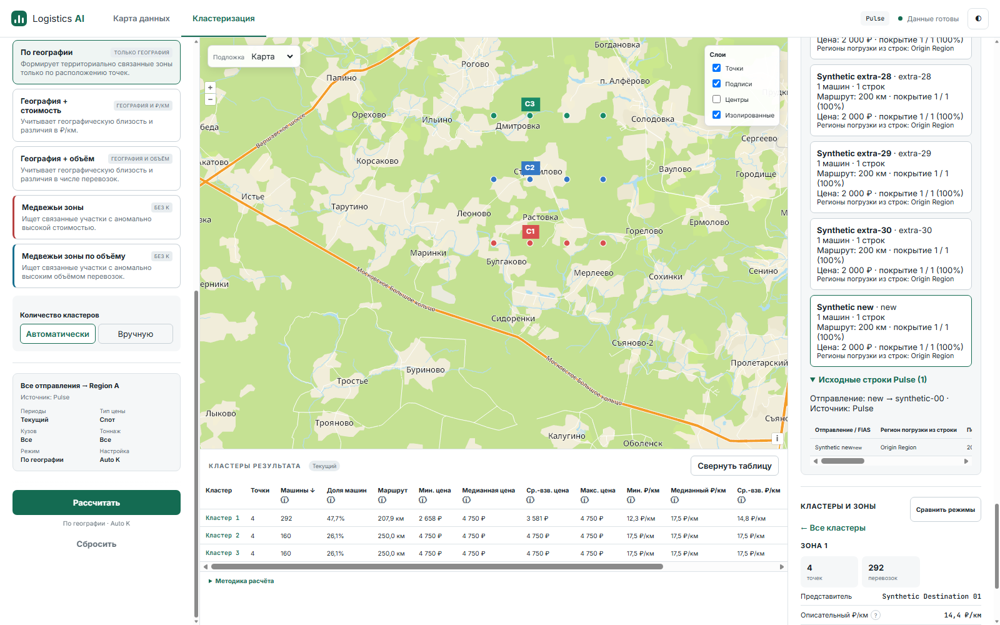

# PF-01 — Pulse source freshness and frontend cache safety

Base: protected main `e4ec54951d37f10b1c607788bee263fda200911c`, PR #13/NPI-07 merged; its exact HEAD required verification passed. Worktree/branch: `.worktrees/pulse-freshness`, `fix/pulse-source-freshness`. Existing worktrees, untracked material, hooks/skills and approved NPI-07 history preserved. Isolated ticket/spec: `.scratch/pulse-source-freshness/`.

## Root cause and cache paths

`executeRun()` accepted `state.result.cache[requestSignature(request)]` synchronously; `runComparison()` accepted `state.comparison.cache[requestSignature(dataset)]` without backend contact. The signature described request intent, not current source generation or saved-result lifetime. P1 only rejected a generation after a detail409; without that request a weekly replacement remained unnoticed. Backend restart/eviction could preserve the same snapshot while losing exact saved membership.

Backend `ClusteringService` location cache keys contain generation/origins/region/filters; graph cache adds spatial context; result cache adds normalized mode/parameters. Existing `_assert_generation`, frozen detail and All resolution already guard their operations. Frontend `ui.pointOrigins` keys contain snapshot/frozen request/destination; `ui.pointRows` adds optional detail_origin_fias. Existing `rejectDataSnapshot` and `rejectUnavailableResult` invalidate these along with result/comparison caches. Reused those helpers; no second invalidation system or calculation introduced.

## Freshness and API design

Previously request equality sufficed. Now a new Calculate/Compare with cached/displayed data calls `POST /api/clustering/revision` before accepting a frontend cache hit. It submits at most6 contexts (five comparison results plus displayed result), each existing `analysis.frozen_request` plus data_snapshot. Read-only `GET` is also available. Response contains opaque data_snapshot and ordered boolean available list. No paths, size/timestamps or private source metadata are returned. All selectors are rejected; exact resolved frozen context is used.

Revision is the existing SHA-256 digest of metadata generation token, including Pulse and coordinate-cache resolved path/size/mtime_ns. `_source_token` now calls existing `FileFingerprint.from_path` rather than `repository.fingerprint()` to avoid loading the CSV index when stat detects a change. New checks do not parse CSV, hash its contents, expand All, refresh LRU order, or run clustering. Generation is checked again before publication. Every revision response (success/error) has Cache-Control:no-store; frontend fetch also uses no-store. Invalid context400, generation race409 and private typed INTERNAL_ERROR500 are tested.

A revision match also requires exact saved-result presence in the service's in-memory result cache. No process UUID, persistent store or external cache is needed. Restart and eviction can leave revision unchanged; available:false forces explicit new calculation. Old detail requests remain existing RESULT_UNAVAILABLE/STALE_DATA_SNAPSHOT failures with no rerun. Presence is checked at the validation instant, not a lease: a later source update/eviction can still make subsequent detail fail safely. Multi-worker cache coherence and retention guarantees are not added.

Source mismatch rejects old generation across all affected frontend caches; same-generation loss rejects only exact unavailable results/comparison copies. Old map/table stays frozen and visibly stale until successful recalculation; summaries/pages cannot restore the old generation. Revision network/server error shows calculation error and never installs a cached result as freshly calculated. Typed generation conflict also marks old display/details stale. AbortController guards cover validation and calculations; cancelled validation cannot mutate reset/replacement state. Internal switching of already displayed comparison variants remains request-free frozen navigation; it does not initiate a new calculation.

## Real Flask + Edge evidence

[Fixture](pulse-freshness-evidence/live_server.py) uses synthetic119 rows,34 origins,12 destinations and real algorithms. Source replacement writes an independent CSV then atomically replaces the source. Restart fixture creates a new service with the same files; eviction clears saved results. The driver uses actual CDP mouse/keyboard input, rendered UI, screenshots and network response bodies; it is automated acceptance, not a human walkthrough. No production/private source was loaded or published.

[Observations](pulse-freshness-evidence/live-observations.json), [network including revision no-store](pulse-freshness-evidence/network.json), [driver](pulse-freshness-evidence/live_edge.mjs), [live log](pulse-freshness-evidence/live-edge.txt).

| Scenario | Observed outcome | Evidence |
|---|---|---|
| Same request/unchanged CSV | One revision request; no second /run; repository loads remain1; HTTP cache not used |02|
| Weekly atomic CSV replacement without page reload | Old cache rejected; failed /run preserves old frozen context/map/table; old summary and source-row page removed/blocked |03|
| Explicit successful All refresh | New snapshot,34→35 resolved origins including new; origin-specific detail contains only new row and exact frozen set |04|
| Five Product modes | Same snapshot in all actual compare variants; repeated Compare validates then reuses, no second /compare |05|
| Evicted saved comparison | Same revision, all available:false; one new /compare |06|
| Restart/lost saved result | Same revision, available:false; one fresh /run |07|
| Revision request503 | No /run; visible error; unverified cached data not reinstalled |08|
| Retry with valid same-generation saved result | Revision succeeds; no new /run |09|
| CSV replacement with cached comparison | Revision rejects all old variants, sends new /compare; no detail409 required |10|
| Real source update during calculation | Revision succeeds; held real Flask calculation then atomic CSV replacement; real409; old frozen display retained/stale |12|
| P2 cached switching/form edit | Bear Volume→Geography; Archive form edit keeps checked Geography; no run/compare from switching |11|

## TDD and quality gates

Public seams agreed by the request: synthetic CSV + Flask HTTP + Product user actions in Node/Edge. [API RED404](pulse-freshness-evidence/red-api.txt) → [GREEN](pulse-freshness-evidence/green-api.txt). [Actual Edge RED source/run](pulse-freshness-evidence/red-edge.txt); all eight cache cases independently rerun against an untouched baseline worktree e4ec549: [baseline RED](pulse-freshness-evidence/red-baseline-all.txt) → [eight GREEN](pulse-freshness-evidence/green-edge.txt). Existing conformant All expansion/frozen contexts/source-update-in-calculation/P1/P2 were regression-tested rather than given manufactured RED. Additional typed revision conflict had genuine [RED](pulse-freshness-evidence/red-generation-race.txt) → [GREEN](pulse-freshness-evidence/green-generation-race.txt), both Calculate and Compare.

New API tests cover no parse on first/check/changed source, presence, restart, eviction, malformed/oversized contexts, private read errors, repeated generation check and no-store errors. Edge covers unchanged/source/restart/network/race for both run/compare, detail invalidation/frozen preservation, retry and cancelled/rapidly repeated revision requests. Existing transport fixtures were updated for the new public endpoint and asynchronous validation boundary; P1 real HTTP fixture uses the real revision API. Initial fixture failures and a restricted-sandbox Edge startup failure were corrected/rerun, never counted as PASS.

Initial full suite:481 passed, zero skipped in105.06s. Final full suite after conflict recovery: **485 passed, zero skipped in113.04s**, including73 mandatory frontend cases. See [full](pulse-freshness-evidence/full.txt) and [JUnit](pulse-freshness-evidence/pytest-results.xml). Required Node/Edge startup, zero-skips assertion, Ruff, locked dependency dry-run (all pins already installed)/pip check, frontend/driver JS syntax, diff whitespace gates recorded in [quality gates](pulse-freshness-evidence/quality-gates.txt). No dependency changed.

## Independent reviews and publication

Independent [Standards](pulse-freshness-evidence/standards-review.md):0 hard breaches/0 actionable smells. Independent [Spec](pulse-freshness-evidence/spec-review.md): one P2 source-change-after-revision finding, fixed and re-reviewed at dcfa3b2;0 remaining. [Ponytail](pulse-freshness-evidence/ponytail-review.md): Ship conditional on exact-HEAD CI. Reviews did not independently rerun the full suite. Genuine [RED](pulse-freshness-evidence/red-calculation-race.txt)?[GREEN28](pulse-freshness-evidence/green-calculation-race.txt) verifies both /run and /compare conflicts after successful revision. Final live checkpoint12 confirms real Flask409 after source replacement inside a held calculation, with native manual-K input and old frozen display retained/stale. Review fixes, if any, require focused regression and final gates. PR targets protected main, exact final HEAD required verification must succeed; no automatic merge. Final PR/CI links and readiness are recorded in the completion report after publication.

## Limits and rollback

Metadata fingerprints are not cryptographic content identity: same path/size/mtime rewrites are undetectable, even though the metadata token is digested. Replace weekly CSV so file metadata changes. Source change after revision validation is possible; subsequent calculation/detail retain generation checks. Saved result presence is not guaranteed future retention; detail fails explicitly after later eviction/restart. No continuous polling or cache coherence infrastructure. Production capacity/SLA and human acceptance unverified. Scalar, explicit multi-origin, regional All, five modes, P1/P2/NPI-04/05/07 are preserved; algorithms/weighted formulas untouched. No drill-up, XLSX, ATI or new Product features. Normal revert, no migration/destructive production operation.
